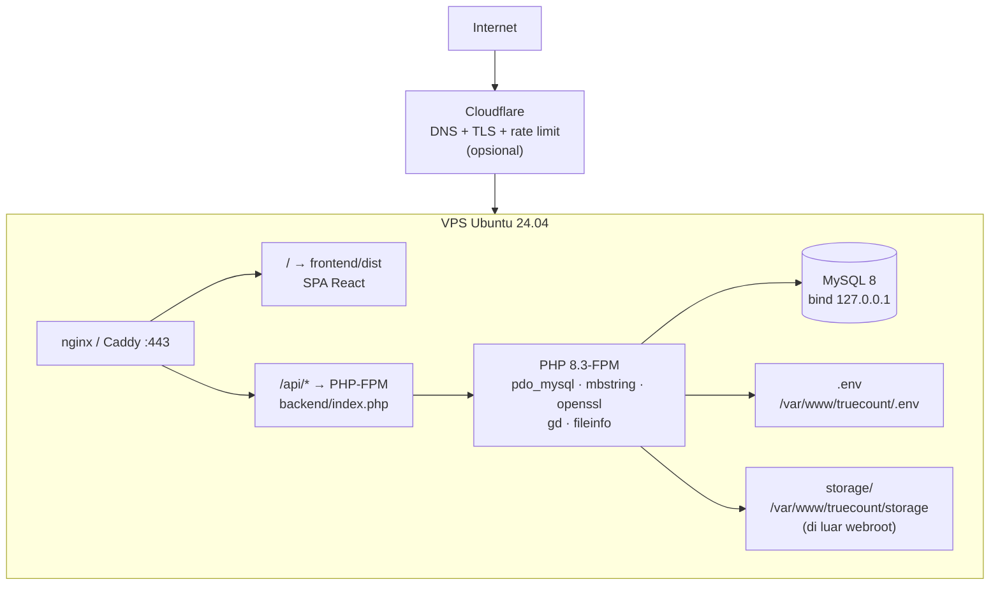

# TrueCount — Deploy to Cloud Plan

> **📦 ARSIP (21 Nov 2026):** Dokumen ini bukan acuan lagi. Deploy ke VPS sekarang diarahkan lewat Docker — lihat [`../deploy/docker.md`](../deploy/docker.md). Alasan arsip: [`README.md`](README.md).
>
> **Status asli:** ⏸️ Ditunda — arah aktif saat itu adalah demo 1 PC.
> **Terakhir diperbarui:** 18 November 2026
> **Dokumen terkait:** [`../deploy/deploy.md`](../deploy/deploy.md) · [`demo-server-config-plan.md`](demo-server-config-plan.md) · [`../desktop/desktop.md`](../desktop/desktop.md)

---

## 0. Ringkasan Eksekutif

Tujuan: membuat TrueCount dapat diakses lewat internet dengan aman, tanpa mengorbankan integritas data pemilihan.

**Keputusan arsitektur:**

1. **Satu VPS menjadi tempat PHP + MySQL + storage.** Frontend dan API disajikan dari origin yang sama (`https://vote.domain-kamu`).
2. **Desktop Tauri menjadi client**, bukan server lokal. PHP lokal tidak di-spawn lagi pada mode online.
3. **Tidak menggunakan skema "DB online + PHP lokal".** Untuk e-voting, skema itu memindahkan batas kepercayaan ke komputer user dan membuat integritas suara tidak bisa dijamin. Detail penolakan ada di [Bagian 2](#2-keputusan-arsitektur).

**Yang perlu diubah sebelum deploy:** URL API yang masih hardcoded, konfigurasi WebAuthn yang masih `localhost`, CORS production, akun seed default, dan path storage yang harus writable di server. Semua ada di [Bagian 5](#5-phase-1--perubahan-kode-sebelum-deploy).

**Estimasi effort:** 3–5 hari kerja (1–2 hari refactor, 0,5 hari provisioning, 1 hari deploy + testing, 0,5 hari hardening/backup).

---

## 1. Tujuan & Ruang Lingkup

### 1.1 Tujuan

- [ ] Web app dapat diakses di `https://vote.domain-kamu` dari browser.
- [ ] Login, undangan, pemilihan, voting, hasil, dan verifikasi blockchain berjalan di server.
- [ ] WebAuthn (Windows Hello/passkey) berfungsi di domain production.
- [ ] File upload (foto kandidat, foto percobaan login, file terenkripsi) tersimpan di server dan bisa di-backup.
- [ ] Desktop Tauri (opsional) memakai API yang sama, sementara USB token tetap berfungsi lokal.
- [ ] Ada backup harian dan prosedur restore yang sudah diuji.

### 1.2 Di luar ruang lingkup (fase ini)

- Offline voting / sinkronisasi suara antar-server.
- Multi-region, load balancer, atau high availability.
- Managed database terpisah (cukup MySQL di VPS yang sama untuk skala proyek ini).
- Aplikasi mobile native.
- Migrasi JWT dari `localStorage` ke httpOnly cookie (bisa masuk fase hardening lanjutan).

### 1.3 Definisi sukses

- `GET https://vote.domain-kamu/api/health` mengembalikan `status: ok` dan `database: connected`.
- Tidak ada request frontend ke `http://localhost:8000` di production.
- Tidak ada error CORS di console browser.
- WebAuthn berhasil register + login di domain HTTPS.
- Vote hanya bisa dilakukan sekali per user per pemilihan.
- Backup bisa direstore ke server bersih.

---

## 2. Keputusan Arsitektur

### 2.1 Yang dipilih: satu VPS, same-origin



**Keuntungan:**

- Satu sumber kebenaran untuk suara, user, hasil, dan audit log.
- Semua otorisasi (`requireAuth`, `requireAdmin`, cek sudah vote) berjalan di server yang dipercaya.
- Query database lokal (sub-milidetik), tidak ada latency WAN per query.
- Update kode dan migrasi cukup di satu tempat.
- Backup dan monitoring terpusat.
- HTTPS + domain memenuhi syarat WebAuthn dan `getUserMedia` (kamera).

### 2.2 Yang ditolak: DB online + PHP lokal

Skema "MySQL dan storage di cloud, PHP tetap di laptop user" **tidak dipakai** untuk e-voting.

Alasan utama:

| Masalah | Konsekuensi |
|---|---|
| Kredensial DB ikut di installer | Siapa pun bisa connect langsung ke MySQL dan membaca/mengubah/menghapus suara, user, hash password, dan blok blockchain. |
| Otorisasi ada di client | User bisa memodifikasi PHP lokal atau memanggil DB langsung; server DB tidak bisa membedakan client sah dan client yang dimodifikasi. |
| JWT secret ada di client | Token admin bisa diforge jika secret sama di semua instalasi. |
| Blockchain tidak menolong | Attacker dengan akses DB bisa menghapus atau mengganti baris chain. Integrity chain hanya berguna jika penulisnya satu server tepercaya. |
| Latency | Setiap query melewati internet. Satu halaman 20 query = 0,6–1 detik; vote + blockchain bisa 2 detik lebih. |
| Transaksi lintas WAN | Rawan timeout/deadlock dan partial commit. |
| Port 3306 | Sering diblok ISP/kampus. Butuh TLS + VPN/allowlist; tidak praktis untuk banyak voter. |
| "Offline" ilusi | DB online tetap butuh internet. PHP lokal tidak membuat aplikasi offline. |
| Browser tidak bisa jalankan PHP | Kalau user mengakses lewat browser, PHP wajib ada di server. |

Catatan: PHP **tidak** mengakses USB token atau kamera. Akses USB dilakukan oleh Rust/Tauri, dan kamera oleh browser/WebView. Jadi tidak ada alasan teknis untuk menaruh PHP di sisi client.

**Pengecualian yang bisa diterima:** demo internal dengan beberapa laptop yang semuanya tepercaya dan tidak ada data nyata. Untuk pemilihan sungguhan, jangan.

### 2.3 Alternatif lain

| Opsi | Verdict | Catatan |
|---|---|---|
| VPS + domain (dokumen ini) | ✅ Dipilih | Kontrol penuh, biaya wajar, cocok untuk WebAuthn dan upload file. |
| Shared hosting | ⚠️ Bisa | Harus support PHP 8.1+, GD, SSH, dan document root yang bisa diatur. Banyak penyedia tidak. |
| Vercel / Netlify | ❌ | Hanya frontend; backend PHP + MySQL + upload tidak jalan. |
| Render / Railway free | ⚠️ | Free tier sleep + filesystem ephemeral; upload dan file terenkripsi bisa hilang. Perlu volume + MySQL bayar. |
| Cloudflare Tunnel ke laptop | ✅ untuk demo | Gratis dan HTTPS, tapi laptop harus selalu nyala. WebAuthn butuh domain tetap, bukan URL acak. |
| Oracle Cloud Always Free | ✅ kalau berhasil signup | Gratis, tapi verifikasi dan kapasitas kadang menyulitkan. |

---

## 3. Arsitektur Target

### 3.1 Peta URL

| Path | Diarahkan ke | Keterangan |
|---|---|---|
| `/` | `frontend/dist` | SPA React + fallback `index.html`. |
| `/assets/*` | `frontend/dist/assets` | Cache immutable. |
| `/api/*` | `backend/index.php` via PHP-FPM | Router sudah menstrip prefix `/api` (`backend/index.php:50`). |
| `/storage/*` | 403 | Data sensitif, tidak boleh disajikan langsung. |
| `/backend/*` | 403 | Kode backend tidak boleh didownload. |
| `/database/*` | 403 | File SQL dan seed tidak boleh didownload. |
| `/.env`, `/.git` | 403 | File sensitif. |

### 3.2 Layout direktori di server

```
/var/www/truecount/
├── .env                         # 640, owner deploy:www-data
├── backend/                     # kode PHP
│   └── storage/
│       ├── logs/                # writable oleh www-data
│       └── private/encrypted-files/  # ciphertext ChaCha20-Poly1305
├── frontend/
│   └── dist/                    # hasil npm run build
├── database/                    # migration + seed (tidak disajikan)
├── storage/                     # writable oleh www-data
│   └── auth_photos/             # foto kamera percobaan login
└── docs/                        # tidak disajikan
```

> **Penting:** `.env` dan `storage/` berada di luar webroot (`frontend/dist`). Jangan pernah menaruhnya di dalam `dist`.

### 3.3 Komponen & versi

| Komponen | Versi | Catatan |
|---|---|---|
| OS | Ubuntu 24.04 LTS | Atau Debian 12. |
| Web server | nginx 1.24+ / Caddy 2 | nginx jadi acuan; Caddy alternatif. |
| PHP | 8.3 FPM | Butuh `pdo_mysql`, `mbstring`, `openssl`, `gd`, `fileinfo`. |
| MySQL | 8.0 | Bind `127.0.0.1`, tidak expose ke publik. |
| Node.js | 20 LTS | Untuk build frontend (bisa di laptop/CI). |
| TLS | Let's Encrypt | Certbot atau Caddy otomatis. |

---

## 4. Prasyarat & Spesifikasi

### 4.1 VPS

- **Minimum demo:** 1 vCPU / 1 GB RAM / 25 GB SSD.
- **Rekomendasi:** 2 vCPU / 2 GB RAM / 40 GB SSD.
- **Alasan 2 GB:** Argon2id memakai 64 MB per hash; beberapa login bersamaan + PHP-FPM + MySQL bisa membuat 1 GB OOM.
- **Swap:** minimal 2 GB.
- **Bandwidth:** kecil; tidak perlu kapasitas besar.

### 4.2 Domain

- Gunakan subdomain, misal `vote.domain-kamu.my.id`.
- **Jangan pakai IP address** untuk WebAuthn. RP ID harus domain.
- Tentukan domain **final sebelum ada user yang enroll WebAuthn**. Mengganti domain = semua credential Windows Hello/passkey tidak valid.
- DNS: A record ke IP VPS. Cloudflare opsional.

### 4.3 Biaya estimasi

| Item | Estimasi |
|---|---|
| VPS 2 vCPU / 2 GB | Rp 100.000–200.000 / bulan |
| Domain `.my.id` | Rp 20.000–50.000 / tahun |
| Domain `.com` | Rp 150.000–250.000 / tahun |
| Cloudflare Free | Rp 0 |
| Backup object storage | Rp 0–50.000 / bulan |
| **Total** | **± Rp 150.000–250.000 / bulan** |

Provider lokal yang menerima QRIS/transfer: Biznet Gio, IDCloudHost, Rumahweb, Dewaweb. Provider Singapura: DigitalOcean, Vultr, Linode.

### 4.4 Yang harus diputuskan sebelum mulai

- [ ] Domain final (contoh: `vote.truecount.my.id`).
- [ ] Provider VPS dan metode pembayaran.
- [ ] Apakah Cloudflare dipakai (proxy + rate limit) atau DNS saja.
- [ ] Apakah desktop Tauri ikut mode online atau tetap offline/kiosk.
- [ ] Siapa yang memegang akses SSH, backup, dan `.env`.
- [ ] Kebijakan retensi foto kamera dan data pemilih.

---

## 5. Phase 1 — Perubahan Kode Sebelum Deploy

Phase ini wajib selesai sebelum server disentuh. Tanpa ini, production akan rusak atau tidak aman.

### 5.1 C1 — Sentralisasi URL API

**Masalah:** `http://localhost:8000` hardcoded di 19 titik / 12 file. Di browser user, `localhost` berarti laptop user, bukan server.

**File yang terdampak:**

- `frontend/src/pages/LoginPage.jsx`
- `frontend/src/pages/RegisterPage.jsx`
- `frontend/src/pages/DashboardPage.jsx`
- `frontend/src/pages/VotePage.jsx`
- `frontend/src/pages/ResultsPage.jsx`
- `frontend/src/pages/ProfileSettingsPage.jsx`
- `frontend/src/pages/UserSecurityLogPage.jsx`
- `frontend/src/pages/EncryptedMessagesPage.jsx`
- `frontend/src/pages/LandingPage.jsx`
- `frontend/src/pages/ServerErrorPage.jsx`
- `frontend/src/components/HealthMonitor.jsx`
- `frontend/src/components/ElectionModals.jsx`

**Perubahan:**

Buat satu modul, misal `frontend/src/lib/api.ts`:

```ts
const configured = (import.meta.env.VITE_API_URL as string | undefined)?.trim()

/**
 * Production web: "/api" (same-origin)
 * Development:    "/api" + Vite proxy, atau URL penuh http://localhost:8000
 * Desktop online: https://vote.domain-kamu/api
 */
export const API_BASE = (configured && configured.length > 0 ? configured : '/api')
  .replace(/\/+$/, '')

export function apiUrl(path: string): string {
  return `${API_BASE}${path.startsWith('/') ? path : `/${path}`}`
}
```

Ganti semua `fetch('http://localhost:8000/...')` menjadi `fetch(apiUrl('/...'))`.

**Vite dev proxy** (`frontend/vite.config.js`):

```js
server: {
  proxy: {
    '/api': {
      target: 'http://127.0.0.1:8000',
      changeOrigin: true,
      rewrite: (path) => path.replace(/^\/api/, ''),
    },
  },
},
```

**Environment:**

```env
# frontend/.env.production
VITE_API_URL=/api
```

```env
# frontend/.env.development (opsional; kalau proxy dipakai, cukup /api)
VITE_API_URL=/api
```

**Acceptance:**

- [ ] `rg "localhost:8000" frontend/src` tidak menghasilkan match.
- [ ] Dev mode tetap jalan lewat Vite proxy.
- [ ] Build production memanggil `/api/...`, bukan localhost.

---

### 5.2 C2 — WebAuthn production-ready

**Masalah:** RP ID dan origin masih `localhost`, mismatch origin hanya di-log, dan `rpIdHash` belum diverifikasi.

**File:**

- `backend/api/auth/webauthn_register_start.php:76-79` → `rp.id = 'localhost'`
- `backend/api/auth/webauthn_register_verify.php:96-100` → `expectedOrigin = 'http://localhost:5173'`
- `backend/api/auth/webauthn_login_verify.php:136-140` → `expectedOrigin = 'http://localhost:5173'`
- `frontend/src/utils/webauthn.ts:11-15` → `getRpId()` memakai hostname
- `frontend/src/hooks/useAuth.ts:80`
- `frontend/src/hooks/useWebAuthn.ts:166,296`
- `frontend/src/pages/ProfileSettingsPage.jsx:184`

**Perubahan backend:**

Tambahkan konfigurasi di `backend/config/app.php`:

```php
define('WEBAUTHN_RP_ID',  $_ENV['WEBAUTHN_RP_ID']  ?? 'localhost');
define('WEBAUTHN_ORIGIN', $_ENV['WEBAUTHN_ORIGIN'] ?? 'http://localhost:5173');
```

Gunakan `WEBAUTHN_RP_ID` di response `rp.id`, dan **tolak** request jika origin tidak cocok:

```php
$origin = $clientData['origin'] ?? '';
if (!hash_equals(WEBAUTHN_ORIGIN, $origin)) {
    jsonResponse(['error' => 'Origin tidak valid.'], 400);
}
```

Verifikasi `rpIdHash` setelah authenticator data diparse:

```php
$expectedRpIdHash = hash('sha256', WEBAUTHN_RP_ID, true);
if (!hash_equals($expectedRpIdHash, $parsedAuthData['rpIdHash'])) {
    jsonResponse(['error' => 'RP ID tidak cocok.'], 400);
}
```

**Perubahan frontend:**

- Untuk web production, gunakan `rp.id` dari backend (bukan override `getRpId()`), atau gunakan `VITE_WEBAUTHN_RP_ID` yang nilainya sama dengan backend.
- Untuk Tauri, origin-nya `http://tauri.localhost` (Windows) / `tauri://localhost` (macOS/Linux). WebAuthn di Tauri **terikat ke origin itu**, bukan ke domain web. Credential web dan desktop tidak otomatis sama.
- Jika desktop online memakai WebAuthn, backend harus mengizinkan origin Tauri secara eksplisit; jika tidak, gunakan USB token untuk MFA desktop.

**Acceptance:**

- [ ] Register WebAuthn di `https://vote.domain-kamu` berhasil.
- [ ] Login WebAuthn berhasil.
- [ ] Origin mismatch ditolak, bukan hanya dicatat.
- [ ] `rpIdHash` diverifikasi.
- [ ] Tidak ada credential yang dibuat dengan RP ID `localhost` di production.

> **Catatan:** Ganti domain setelah ada user = semua credential WebAuthn lama invalid. Tentukan domain sekarang.

---

### 5.3 C3 — CORS production

**Masalah:** `backend/helpers/response.php:23-26` mengizinkan **semua** origin localhost di port berapa pun. Ini berguna untuk dev, tapi tidak untuk production.

**Perubahan:**

```php
$isProduction = (APP_ENV === 'production');
$allowedOrigins = [FRONTEND_ORIGIN];

if (!$isProduction) {
    $allowedOrigins[] = 'http://tauri.localhost';
    $allowedOrigins[] = 'tauri://localhost';
}

$isLocalOrigin = !$isProduction && (bool) preg_match(
    '#^https?://(localhost|127\.0\.0\.1|\[::1\])(:\d+)?$#i',
    $origin
);
```

Jika desktop online memakai API cloud, tambahkan origin Tauri secara eksplisit ke `$allowedOrigins`, jangan lewat regex localhost.

Header `Access-Control-Allow-Private-Network: true` hanya diperlukan untuk desktop lokal; di production sebaiknya dihilangkan atau dibatasi.

**Acceptance:**

- [ ] Production hanya mengizinkan `FRONTEND_ORIGIN` (+ origin Tauri jika dipakai).
- [ ] Dev mode tetap bisa memakai Vite di port 5173.
- [ ] Preflight `OPTIONS` tetap mengembalikan 204.

---

### 5.4 C4 — Storage, permission, dan kunci enkripsi

**Path yang harus writable oleh `www-data`:**

| Path | Dipakai oleh |
|---|---|
| `backend/storage/logs/` | `helpers/logger.php`, `index.php` error log |
| `backend/storage/private/encrypted-files/` | `FileEncryptionService` (foto kandidat) |
| `storage/auth_photos/` | `login.php`, `attempts_log.php`, `webauthn_login_verify.php`, `authenticate_verify.php` |
| `backend/uploads/` | Legacy foto kandidat (opsional) |

**Kunci enkripsi:**

- `ENCRYPTION_KEY_B64` → AES-256-GCM (`AESGCMService.php:21`)
- `CHACHA20_KEY_B64` → ChaCha20-Poly1305 (`ChaCha20Poly1305Service.php:19`)

**Aturan:**

- Backup `.env` secara offline dan terenkripsi.
- **Jangan regenerate** kunci saat pindah server. Data lama (ballot, pesan, file) tidak akan bisa didekripsi.
- `chmod 600` untuk `.env`, owner deploy user / `www-data`.

**Generate kunci baru (hanya untuk instalasi baru):**

```bash
openssl rand -base64 32   # ENCRYPTION_KEY_B64
openssl rand -base64 32   # CHACHA20_KEY_B64
php -r "echo bin2hex(random_bytes(32)), PHP_EOL;"   # JWT_SECRET
```

---

### 5.5 C5 — Akun seed & role dev

`php database/migrate.php --seed` menjalankan semua seed, termasuk:

- `admin` / `Admin@1234`
- `pemilih1` / `Pemilih@123`
- `pemilih2` / `Pemilih@123`
- `dev` / `Dev@1234`

**Untuk production, jangan jalankan `--seed`.**

Gunakan migrasi + seed admin saja:

```bash
php database/migrate.php
sudo mysql < database/seeds/001_admin.sql
```

Lalu:

- [ ] Login sebagai admin dan ganti password.
- [ ] Hapus akun `dev` dan user dummy jika terlanjur di-seed.
- [ ] Nonaktifkan atau batasi halaman `/dev` jika tidak diperlukan.
- [ ] Pastikan tidak ada akun dengan password default.

Jika terlanjur `--seed` di database baru:

```sql
DELETE FROM users WHERE username IN ('pemilih1', 'pemilih2', 'dev');
```

> Jangan jalankan SQL ini di database yang sudah berisi data nyata tanpa memeriksa foreign key.

---

### 5.6 C6 — Desktop Tauri: mode online (opsional)

Saat ini `frontend/src-tauri/src/lib.rs:132-199` selalu men-spawn PHP lokal di port 8000. Untuk mode online:

- Tambahkan flag build/runtime, misal `TRUECOUNT_ONLINE=1`.
- Jika online:
  - Jangan panggil `spawn_php_backend()`.
  - Frontend memakai `VITE_API_URL=https://vote.domain-kamu/api`.
  - Backend harus mengizinkan origin `http://tauri.localhost` / `tauri://localhost`.
- Jika offline:
  - Tetap spawn PHP + MySQL lokal seperti sekarang.
- USB token tetap berjalan lokal (Rust + `.truecount_token`), tidak terpengaruh.
- WebAuthn desktop tetap terikat `tauri.localhost`; jangan berharap credential web bisa dipakai di desktop.

**Build desktop online (PowerShell):**

```powershell
cd frontend
$env:VITE_API_URL = "https://vote.domain-kamu/api"
npm run desktop:build
```

---

### 5.7 C7 — Checklist kode sebelum deploy

- [ ] C1 API base selesai; tidak ada `localhost:8000`.
- [ ] C2 WebAuthn env + origin enforcement + rpIdHash.
- [ ] C3 CORS production.
- [ ] C4 path storage & permission.
- [ ] C5 seed/admin/dev.
- [ ] C6 desktop mode (jika dipakai).
- [ ] `.env.example` diperbarui dengan `WEBAUTHN_RP_ID` dan `WEBAUTHN_ORIGIN`.
- [ ] `npm run build` sukses.
- [ ] `php -l` sukses untuk file PHP yang diubah.
- [ ] `php tests/api_test.php` sukses di lokal.

---

## 6. Phase 2 — Provisioning VPS

### 6.1 Akses awal

```bash
# Dari laptop
ssh root@IP_VPS
```

Buat user deploy:

```bash
adduser truecount
usermod -aG sudo truecount
rsync --archive --chown=truecount:truecount ~/.ssh /home/truecount
```

Login sebagai `truecount`, lalu:

```bash
sudo apt update && sudo apt upgrade -y
sudo apt install -y ufw fail2ban unattended-upgrades
sudo ufw allow OpenSSH
sudo ufw allow 'Nginx Full'
sudo ufw enable
sudo timedatectl set-timezone Asia/Jakarta
```

> Pastikan `ufw allow OpenSSH` sebelum `ufw enable`, supaya sesi SSH tidak terputus.

### 6.2 Install paket

```bash
sudo apt install -y \
  nginx mysql-server \
  php8.3-fpm php8.3-cli php8.3-mysql php8.3-mbstring \
  php8.3-xml php8.3-gd php8.3-curl php8.3-zip \
  certbot python3-certbot-nginx git unzip
```

Verifikasi:

```bash
php -v
php -m | grep -E 'pdo_mysql|mbstring|openssl|gd|fileinfo'
php -r "var_dump(defined('PASSWORD_ARGON2ID'));"   # harus true
php -r "var_dump(function_exists('imagecreatefromwebp'));"  # harus true
nginx -v
mysql --version
```

> `gd` wajib ada. Tanpa GD, upload foto kandidat dan steganografi akan gagal.

### 6.3 MySQL

```bash
sudo mysql_secure_installation
sudo mysql
```

```sql
CREATE DATABASE truecount_db
  CHARACTER SET utf8mb4
  COLLATE utf8mb4_unicode_ci;

CREATE USER 'truecount_user'@'localhost'
  IDENTIFIED BY 'PASSWORD_KUAT_DI_SINI';

GRANT ALL PRIVILEGES ON truecount_db.* TO 'truecount_user'@'localhost';
FLUSH PRIVILEGES;
```

Pastikan MySQL hanya listen lokal:

```bash
sudo grep -R "^bind-address" /etc/mysql/mysql.conf.d/
# bind-address = 127.0.0.1
sudo systemctl restart mysql
```

Cek dari luar VPS:

```bash
nc -vz vote.domain-kamu 3306
# harus gagal / timeout
```

### 6.4 Direktori aplikasi

```bash
sudo mkdir -p /var/www/truecount
sudo chown -R truecount:www-data /var/www/truecount
sudo -u truecount git clone <url-repo> /var/www/truecount
```

Atau upload via `rsync` dari laptop.

Buat folder runtime:

```bash
cd /var/www/truecount
mkdir -p storage/auth_photos backend/storage/logs backend/storage/private/encrypted-files backend/uploads
sudo chown -R www-data:www-data storage backend/storage backend/uploads
sudo chmod -R 750 storage backend/storage backend/uploads
```

---

## 7. Phase 3 — Konfigurasi & Deploy Aplikasi

### 7.1 `.env` production

Buat `/var/www/truecount/.env`:

```env
# ── Database ─────────────────────────────────────────────
DB_HOST=localhost
DB_PORT=3306
DB_NAME=truecount_db
DB_USER=truecount_user
DB_PASS=PASSWORD_KUAT_DI_SINI

# ── App ──────────────────────────────────────────────────
APP_ENV=production
FRONTEND_ORIGIN=https://vote.domain-kamu

# ── JWT ──────────────────────────────────────────────────
JWT_SECRET=GANTI_DENGAN_64_KARAKTER_HEX_ACAK
JWT_EXPIRE=3600

# ── Undangan ─────────────────────────────────────────────
INVITE_EXPIRE_DAYS=7

# ── Encryption ───────────────────────────────────────────
ENCRYPTION_KEY_B64=HASIL_OPENSSL_RAND_BASE64_32
CHACHA20_KEY_B64=HASIL_OPENSSL_RAND_BASE64_32

# ── WebAuthn (baru) ──────────────────────────────────────
WEBAUTHN_RP_ID=vote.domain-kamu
WEBAUTHN_ORIGIN=https://vote.domain-kamu
```

Permission:

```bash
sudo chown truecount:www-data /var/www/truecount/.env
sudo chmod 640 /var/www/truecount/.env
```

### 7.2 Migrasi & admin

```bash
cd /var/www/truecount

# Opsi A: user DB punya privilege CREATE DATABASE
php database/migrate.php

# Opsi B: buat DB sebagai root dulu, lalu migrasi sebagai root/migration user
# sudo mysql -e "CREATE DATABASE IF NOT EXISTS truecount_db ..."
# sudo -u truecount DB_USER=root DB_PASS=... php database/migrate.php

# Seed admin saja (jangan --seed di production)
sudo mysql < database/seeds/001_admin.sql
```

> `migrate.php` menjalankan `CREATE DATABASE IF NOT EXISTS`. Jika user aplikasi tidak punya privilege global `CREATE`, jalankan migrasi sebagai root atau user migrasi khusus. Setelah migrasi, pertimbangkan mempersempit user aplikasi menjadi `SELECT, INSERT, UPDATE, DELETE` pada `truecount_db.*`, dan gunakan user migrasi terpisah untuk DDL.

Login admin default:

| Field | Value |
|---|---|
| Username | `admin` |
| Password | `Admin@1234` |

**Segera ganti password** setelah login pertama.

### 7.3 Build frontend

Di laptop/CI (disarankan, hemat RAM VPS):

```bash
# macOS / Linux / Git Bash
cd frontend
npm ci
VITE_API_URL=/api npm run build
```

```powershell
# Windows PowerShell
cd frontend
npm ci
$env:VITE_API_URL = "/api"
npm run build
```

Upload hasil build:

```bash
rsync -avz --delete frontend/dist/ truecount@IP_VPS:/var/www/truecount/frontend/dist/
```

Atau build langsung di VPS jika Node.js terinstall.

### 7.4 Konfigurasi nginx

`/etc/nginx/sites-available/truecount`:

```nginx
server {
    listen 80;
    listen [::]:80;
    server_name vote.domain-kamu;

    root /var/www/truecount/frontend/dist;
    index index.html;
    client_max_body_size 25m;

    # Security headers dasar
    add_header X-Content-Type-Options "nosniff" always;
    add_header X-Frame-Options "DENY" always;
    add_header Referrer-Policy "strict-origin-when-cross-origin" always;
    add_header Permissions-Policy "camera=(self), microphone=(), geolocation=()" always;

    # API → PHP-FPM
    location = /api {
        return 308 /api/;
    }

    location /api/ {
        include fastcgi_params;
        fastcgi_param SCRIPT_FILENAME /var/www/truecount/backend/index.php;
        fastcgi_param SCRIPT_NAME /index.php;
        fastcgi_param DOCUMENT_ROOT /var/www/truecount/backend;
        fastcgi_param REQUEST_URI $request_uri;
        fastcgi_param HTTP_AUTHORIZATION $http_authorization;
        fastcgi_pass unix:/run/php/php8.3-fpm.sock;
        fastcgi_read_timeout 120s;
    }

    # SPA fallback
    location / {
        try_files $uri $uri/ /index.html;
    }

    # Jangan pernah menyajikan file sensitif
    location ~ /\.(?!well-known) { deny all; }
    location ^~ /storage/  { deny all; }
    location ^~ /backend/  { deny all; }
    location ^~ /database/ { deny all; }
    location ^~ /docs/     { deny all; }

    # Cache aset Vite (nama file sudah ber-hash)
    location /assets/ {
        expires 1y;
        try_files $uri =404;
    }

    location = /index.html {
        expires -1;
    }
}
```

Aktifkan:

```bash
sudo ln -s /etc/nginx/sites-available/truecount /etc/nginx/sites-enabled/
sudo rm -f /etc/nginx/sites-enabled/default
sudo nginx -t
sudo systemctl reload nginx
```

> `REQUEST_URI` harus tetap `/api/...`; router `backend/index.php:50` yang menstrip prefix `/api`. Jangan set `SCRIPT_FILENAME` ke `$document_root/index.php` karena `$document_root` menunjuk ke `frontend/dist`.

### 7.5 HTTPS

```bash
sudo certbot --nginx -d vote.domain-kamu --redirect
```

Setelah HTTPS stabil, tambahkan HSTS:

```nginx
add_header Strict-Transport-Security "max-age=31536000" always;
```

Jangan tambahkan `includeSubDomains` sebelum yakin semua subdomain memakai HTTPS.

### 7.6 PHP-FPM tuning

Buat `/etc/php/8.3/fpm/conf.d/99-truecount.ini`:

```ini
upload_max_filesize = 25M
post_max_size = 26M
memory_limit = 256M
max_execution_time = 120
max_input_time = 120
display_errors = Off
log_errors = On
date.timezone = Asia/Jakarta
```

```bash
sudo systemctl restart php8.3-fpm
```

### 7.7 Cloudflare (opsional)

- DNS A record ke IP VPS. Saat menerbitkan sertifikat origin dengan Certbot, gunakan mode **DNS only** dulu; setelah sertifikat terbit, baru aktifkan proxy. Alternatif: gunakan DNS-01 challenge.
- SSL/TLS mode: **Full (strict)**.
- Rate limit `/api/auth/login` (misal 5 request/menit per IP).
- Jangan aktifkan challenge pada `/api/*` jika desktop client memanggil API; bisa memblokir non-browser.
- Jika proxy aktif, backend melihat IP Cloudflare. Tambahkan `real_ip` di nginx atau gunakan header `CF-Connecting-IP` agar log audit mencatat IP asli.

---

## 8. Phase 4 — Testing & Acceptance

### 8.1 Smoke test

```bash
curl -s https://vote.domain-kamu/api/health
# {"status":"ok","app":"TrueCount","database":"connected",...}

curl -s -o /dev/null -w "%{http_code}\n" https://vote.domain-kamu/
# 200

curl -s -o /dev/null -w "%{http_code}\n" https://vote.domain-kamu/.env
# 403 / 404

curl -s -o /dev/null -w "%{http_code}\n" https://vote.domain-kamu/storage/auth_photos/
# 403

curl -s -o /dev/null -w "%{http_code}\n" https://vote.domain-kamu/backend/index.php
# 403
```

### 8.2 Checklist fungsional

- [ ] Halaman landing terbuka.
- [ ] Login admin berhasil, JWT diterima.
- [ ] Ganti password admin berhasil.
- [ ] Buat undangan; register user baru via link undangan.
- [ ] User baru diarahkan ke setup keamanan.
- [ ] Register WebAuthn di HTTPS berhasil.
- [ ] Login WebAuthn berhasil.
- [ ] Kamera hanya menyala di halaman `/masuk` dan foto percobaan login tersimpan.
- [ ] Admin bisa melihat log percobaan login + foto.
- [ ] Buat pemilihan + kandidat.
- [ ] Upload foto kandidat (JPEG/PNG/WebP) berhasil; tidak ada error GD.
- [ ] Foto kandidat tampil (dekripsi dari private storage).
- [ ] Daftarkan voter ke pemilihan.
- [ ] Vote berhasil; vote kedua ditolak.
- [ ] Hasil tally benar.
- [ ] Seal blockchain + verify berhasil.
- [ ] Buat & ambil pesan terenkripsi.
- [ ] Halaman `/dev` hanya bisa diakses admin/dev.
- [ ] Desktop online (jika dipakai) bisa login dan USB token terdeteksi.
- [ ] Tidak ada error CORS di console.
- [ ] Tidak ada request ke `localhost:8000` di Network tab.

### 8.3 Checklist keamanan

- [ ] `APP_ENV=production`.
- [ ] `display_errors=Off`; error masuk log file.
- [ ] `.env` tidak bisa diakses dari web.
- [ ] `storage/`, `backend/`, `database/` tidak bisa diakses dari web.
- [ ] MySQL tidak terbuka ke internet.
- [ ] Firewall hanya 22/80/443.
- [ ] SSH key-only; password login disabled.
- [ ] Akun default (`admin`, `dev`, `pemilih1/2`) sudah diganti/dihapus.
- [ ] CORS tidak mengizinkan localhost di production.
- [ ] Rate limit login aktif.
- [ ] HTTPS + HSTS.
- [ ] Backup berjalan dan sudah pernah direstore.
- [ ] Kunci enkripsi dibackup offline.
- [ ] Log tidak berisi password/JWT.
- [ ] Foto kamera memiliki kebijakan retensi.

---

## 9. Phase 5 — Backup, Monitoring, Operasional

### 9.1 Backup

Yang harus dibackup:

1. Database (`mysqldump`).
2. `storage/` (foto, file terenkripsi).
3. `backend/storage/` (log, opsional).
4. `.env` (terenkripsi; berisi kunci enkripsi).
5. Konfigurasi nginx/PHP (opsional, bisa dari repo).

Contoh script `/usr/local/bin/truecount-backup.sh`:

```bash
#!/usr/bin/env bash
set -euo pipefail

STAMP="$(date +%F-%H%M)"
DEST="/var/backups/truecount/${STAMP}"
mkdir -p "$DEST"

# Gunakan ~/.my.cnf atau --defaults-extra-file; jangan taruh password di script
mysqldump --single-transaction --routines --triggers \
  --defaults-extra-file=/etc/truecount/backup.cnf \
  truecount_db | gzip > "$DEST/db.sql.gz"

tar -czf "$DEST/storage.tar.gz" \
  -C /var/www/truecount storage backend/storage

install -m 600 /var/www/truecount/.env "$DEST/env.backup"

# Enkripsi sebelum upload (contoh: age)
# age -r "$BACKUP_PUBLIC_KEY" -o "$DEST.tar.gz.age" ...

# Upload ke object storage (contoh: rclone)
# rclone copy "$DEST" remote:truecount-backup/"$STAMP"

find /var/backups/truecount -mindepth 1 -maxdepth 1 -type d -mtime +14 -exec rm -rf {} +
```

Buat file kredensial backup dengan permission 600:

```bash
sudo mkdir -p /etc/truecount
sudo tee /etc/truecount/backup.cnf >/dev/null <<'EOF'
[client]
user=truecount_backup
password=PASSWORD_BACKUP
host=localhost
EOF
sudo chmod 600 /etc/truecount/backup.cnf
```

User backup cukup diberi privilege `SELECT, LOCK TABLES, SHOW VIEW, EVENT, TRIGGER` pada `truecount_db.*`.

Cron:

```cron
0 2 * * * /usr/local/bin/truecount-backup.sh >> /var/log/truecount-backup.log 2>&1
```

**Retensi yang disarankan:** 7 harian + 4 mingguan + 3 bulanan.

**Restore drill:** minimal sekali sebelum demo. Backup yang belum pernah direstore belum bisa dipercaya.

### 9.2 Monitoring

- Uptime: Uptime Kuma / Better Stack / Healthchecks.io → `GET /api/health`.
- Disk: alert jika > 80%.
- RAM & swap: alert jika > 85%.
- Log error: `backend/storage/logs/app.log`, `php_errors.log`, nginx error log.
- Backup: alert jika cron gagal.

### 9.3 Update procedure

1. Backup DB + storage.
2. `git pull` di `/var/www/truecount`.
3. `php database/migrate.php` (setelah backup).
4. Build frontend baru, upload ke `frontend/dist`.
5. `sudo systemctl reload php8.3-fpm nginx`.
6. Smoke test `/api/health`, login, vote.
7. Jika gagal, restore dari backup dan checkout commit sebelumnya.

**Jangan** menjalankan `migrate.php --fresh` di production.

### 9.4 Log rotation

Buat `/etc/logrotate.d/truecount`:

```
/var/www/truecount/backend/storage/logs/*.log {
    daily
    rotate 14
    compress
    missingok
    notifempty
    copytruncate
}
```

---

## 10. Phase 6 — Desktop Tauri (Follow-up)

Jika desktop ingin memakai server cloud:

- [ ] Tambahkan flag `online` pada build Tauri.
- [ ] Jika online, `spawn_php_backend()` tidak dipanggil.
- [ ] `VITE_API_URL=https://vote.domain-kamu/api` saat build.
- [ ] CORS backend mengizinkan `http://tauri.localhost` / `tauri://localhost`.
- [ ] USB token tetap berjalan lokal.
- [ ] WebAuthn desktop terikat origin `tauri.localhost`; credential web dan desktop terpisah.
- [ ] Jika tidak butuh WebAuthn di desktop, gunakan USB token sebagai MFA utama desktop.

**Matriks mode:**

| Mode | PHP | MySQL | Storage | API | USB | WebAuthn |
|---|---|---|---|---|---|---|
| Web cloud | VPS | VPS | VPS | `/api` | ❌ | ✅ domain |
| Desktop online | ❌ | ❌ | VPS | `https://domain/api` | ✅ lokal | ⚠️ `tauri.localhost` |
| Desktop offline | lokal | lokal | lokal | `localhost:8000` | ✅ lokal | ⚠️ `tauri.localhost` |

---

## 11. Risiko & Mitigasi

| Risiko | Dampak | Mitigasi |
|---|---|---|
| Domain berubah setelah user enroll WebAuthn | Credential invalid | Tentukan domain final sebelum deploy; komunikasikan. |
| Kunci enkripsi hilang | Ballot/pesan/file tidak bisa dibuka | Backup `.env` offline + terenkripsi; jangan regenerate. |
| `.env` ikut ter-commit | Kredensial & kunci bocor | `.gitignore`, scan repo, rotate jika bocor. |
| VPS mati | Layanan down | Snapshot VPS + backup harian; terima downtime untuk skala proyek. |
| Disk penuh karena foto | Upload/vote gagal | Batas upload 25 MB; monitoring disk; retensi foto. |
| Trafik login spike | Argon2 menghabiskan RAM | 2 GB RAM, rate limit, PHP-FPM `pm.max_children` wajar. |
| Migrasi schema merusak data | Data hilang | Backup sebelum migrasi; jangan `--fresh` di production. |
| CORS terlalu terbuka | API bisa dipanggil origin lain | Batasi `FRONTEND_ORIGIN`; hapus regex localhost di production. |
| Foto kamera sensitif | Pelanggaran privasi | Akses admin-only, retensi, enkripsi disk/backup, consent. |
| Desktop offline vs web beda data | Kebingungan user | Pilih satu mode utama; dokumentasikan. |

---

## 12. Timeline & Pembagian Tugas

| Fase | Estimasi | Owner |
|---|---|---|
| C1 API base + Vite proxy | 0,5 hari | Frontend |
| C2 WebAuthn env + enforcement | 0,5–1 hari | Backend/Auth |
| C3 CORS + C4 storage/permission | 0,5 hari | Backend |
| C5 seed/admin/dev | 0,25 hari | Backend |
| C6 desktop online (opsional) | 0,5–1 hari | Desktop |
| Provisioning VPS | 0,5 hari | DevOps |
| Deploy + nginx + TLS | 0,5 hari | DevOps |
| Testing end-to-end | 1 hari | Semua |
| Backup + hardening | 0,5 hari | DevOps |
| **Total** | **3–5 hari** | |

---

## 13. Pertanyaan Terbuka

- [ ] Domain final apa? (`vote.truecount.my.id`?)
- [ ] Provider VPS mana? (lokal vs Singapura)
- [ ] Cloudflare dipakai atau DNS saja?
- [ ] Desktop ikut online atau tetap offline/kiosk?
- [ ] Apakah ada kebutuhan offline voting?
- [ ] Siapa yang memegang akses SSH, DB, dan backup?
- [ ] Berapa lama retensi foto kamera dan log audit?
- [ ] Apakah data pemilih nyata akan dipakai? Jika ya, perlu consent & kebijakan privasi.

---

## 14. Acceptance Criteria

Deploy dianggap selesai jika:

- [ ] `https://vote.domain-kamu` menampilkan landing page.
- [ ] `/api/health` `ok` + database connected.
- [ ] Login admin/voter berhasil.
- [ ] WebAuthn register + login berhasil di domain.
- [ ] Vote, hasil, dan verifikasi blockchain berjalan.
- [ ] Upload foto kandidat berhasil dan foto tampil.
- [ ] Tidak ada request ke `localhost:8000`.
- [ ] Tidak ada error CORS.
- [ ] `.env`, `storage/`, `backend/`, `database/` tidak bisa diakses publik.
- [ ] MySQL tidak terbuka dari internet.
- [ ] Backup harian berjalan dan restore sudah diuji.
- [ ] Akun default sudah diganti/dihapus.
- [ ] `docs/deploy/deploy.md` diperbarui dengan URL, path, dan langkah production yang baru.

---

## 15. Lampiran

### A. Perintah cepat dari laptop ke VPS

```bash
# Sync kode (setelah build frontend).
# Jangan pernah meng-overwrite .env production dari laptop.
rsync -avz --delete \
  --exclude='.git' \
  --exclude='.env' \
  --exclude='.env.*' \
  --exclude='node_modules' \
  --exclude='frontend/node_modules' \
  --exclude='frontend/dist' \
  --exclude='frontend/src-tauri/target' \
  --exclude='backend/storage/' \
  --exclude='storage/' \
  ./ truecount@IP_VPS:/var/www/truecount/

# Build frontend (PowerShell)
cd frontend
$env:VITE_API_URL = "/api"
npm run build

# Upload dist. --delete aman karena .env dan storage tidak ada di dalam dist.
rsync -avz --delete dist/ truecount@IP_VPS:/var/www/truecount/frontend/dist/
```

### B. Cek service

```bash
sudo systemctl status nginx
sudo systemctl status php8.3-fpm
sudo systemctl status mysql
sudo nginx -t
sudo tail -f /var/log/nginx/error.log
sudo tail -f /var/www/truecount/backend/storage/logs/app.log
```

### C. Cleanup akun demo (hanya DB baru)

```sql
DELETE FROM users WHERE username IN ('pemilih1', 'pemilih2', 'dev');
```

### D. Referensi file penting

| File | Fungsi |
|---|---|
| `backend/index.php` | Router API; menstrip prefix `/api` di baris 50. |
| `backend/config/env.php` | Loader `.env`; wajib ada di root proyek. |
| `backend/config/app.php` | `APP_ENV`, `FRONTEND_ORIGIN`, `JWT_SECRET`. |
| `backend/helpers/response.php` | CORS + `jsonResponse()`. |
| `backend/api/auth/webauthn_register_start.php` | RP ID WebAuthn. |
| `backend/api/auth/webauthn_*_verify.php` | Origin + rpIdHash WebAuthn. |
| `backend/services/crypto/FileEncryptionService.php` | Storage `backend/storage/private/encrypted-files`. |
| `backend/helpers/logger.php` | Log `backend/storage/logs`. |
| `frontend/src-tauri/src/lib.rs` | Spawn PHP lokal (harus di-skip untuk mode online). |
| `frontend/src-tauri/tauri.conf.json` | Bundle backend sebagai resource (offline mode). |

### E. Rollback

1. Stop deploy baru; restore DB dari backup terakhir.
2. `git checkout <commit-sebelumnya>`.
3. Restore `frontend/dist` dari backup/symlink rilis sebelumnya.
4. `sudo systemctl reload php8.3-fpm nginx`.
5. Smoke test.

---

> **Catatan akhir:** Dokumen ini adalah rencana. Sebelum eksekusi, selesaikan Phase 1 (perubahan kode) dan putuskan domain final. Jangan mengeksekusi `--fresh` atau `--seed` di database production yang sudah berisi data nyata.
