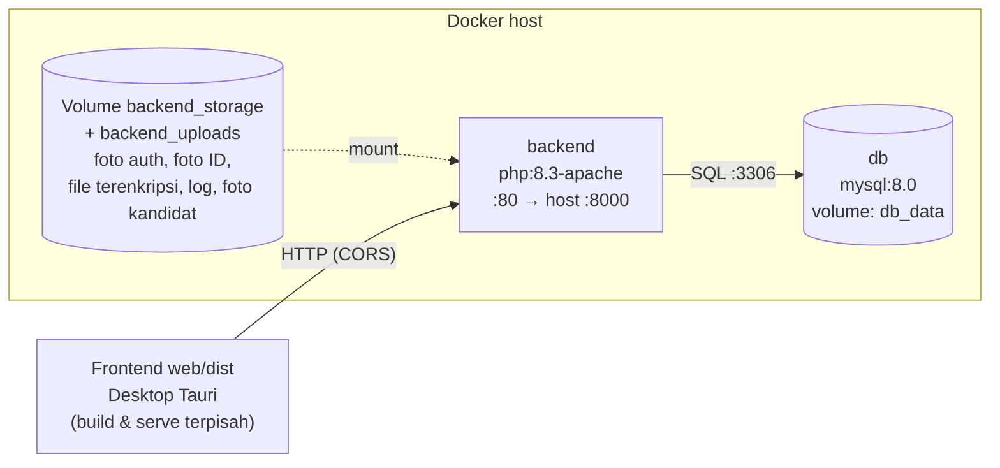

# TrueCount - Deploy dengan Docker (Backend + MySQL)

Panduan ini menjalankan **backend PHP + Apache** dan **MySQL 8** di dalam Docker.
Frontend React tetap di-build terpisah (web statis atau app desktop Tauri), lalu
diarahkan ke alamat backend container.

> Untuk deploy tanpa Docker (VPS + Nginx/Apache native), lihat [`deploy.md`](deploy.md).
> Untuk rencana cloud jangka panjang yang sudah diarsipkan, lihat [`../archive/deploy-to-cloud-plan.md`](../archive/deploy-to-cloud-plan.md).

---

## 1. Arsitektur



Yang **tidak** ada di container:

- Frontend React/Vite (`frontend/`) — build sendiri, serve lewat Nginx/CDN/hosting statis.
- Aplikasi desktop Tauri — tetap client, memanggil API container.
- Akses kamera & USB token — dilakukan browser/Tauri di sisi client, bukan PHP.

---

## 2. Prasyarat

| Kebutuhan        | Versi minimum | Catatan                          |
|------------------|---------------|----------------------------------|
| Docker Engine    | 24.x          | Docker Desktop di Windows/macOS  |
| Docker Compose   | v2 (`docker compose`) | Sudah bundle dengan Docker Desktop |
| PHP CLI (host)   | 8.1+          | Hanya untuk generate secret      |

Cek:

```bash
docker --version
docker compose version
```

---

## 3. Quick start

### 3.1 Siapkan file environment

```bash
# Linux / macOS
cp .env.docker.example .env.docker

# Windows PowerShell
Copy-Item .env.docker.example .env.docker
```

Buka `.env.docker` lalu isi **minimal** nilai berikut:

```env
DB_PASS=password-db-yang-kuat
MYSQL_ROOT_PASSWORD=password-root-yang-kuat
JWT_SECRET=<hasil generate>
ENCRYPTION_KEY_B64=<hasil generate>
CHACHA20_KEY_B64=<hasil generate>
FRONTEND_ORIGIN=http://localhost:5173
```

Generate secret (jalankan dua kali untuk dua key enkripsi):

```bash
# JWT_SECRET
php -r "echo bin2hex(random_bytes(48)), PHP_EOL;"

# ENCRYPTION_KEY_B64 dan CHACHA20_KEY_B64 (butuh 32 byte)
php -r "echo base64_encode(random_bytes(32)), PHP_EOL;"
```

> **Penting:** `ENCRYPTION_KEY_B64` dan `CHACHA20_KEY_B64` harus tetap sama
> selama data lama masih dipakai. Mengganti key membuat foto log dan file
> terenkripsi lama tidak bisa dibuka.

### 3.2 Build & jalankan

```bash
docker compose --env-file .env.docker up -d --build
```

Cek status:

```bash
docker compose --env-file .env.docker ps
docker compose --env-file .env.docker logs -f backend
```

### 3.3 Verifikasi

```bash
curl http://localhost:8000/health
```

Respons yang diharapkan:

```json
{
  "status": "ok",
  "app": "TrueCount",
  "database": "connected",
  "server_label": "Docker Demo",
  "time": "..."
}
```

Kalau `database` bernilai `disconnected`, cek log `db` dan pastikan
`DB_PASS` sama dengan `MYSQL_PASSWORD` (di compose keduanya memakai `DB_PASS`).

### 3.4 Akun admin

Migrasi dijalankan otomatis saat container start (`RUN_MIGRATIONS=true`).
Seed **tidak** otomatis aktif. Untuk demo, seed bisa dijalankan sekali:

```bash
docker compose --env-file .env.docker exec backend php database/migrate.php --seed
```

Akun default dari seed:

| Username | Password     | Role  |
|----------|--------------|-------|
| `admin`  | `Admin@1234` | admin |
| `dev`    | `Dev@1234`   | dev   |

> Ganti password setelah login pertama. Jangan aktifkan `RUN_SEED=true`
> di production.

---

## 4. Variabel environment

Semua variabel dibaca dari environment container (bukan dari file `.env` di
dalam image). Daftar lengkap ada di [`.env.docker.example`](../../.env.docker.example).

| Variabel | Wajib | Default | Keterangan |
|---|---|---|---|
| `BACKEND_PORT` | tidak | `8000` | Port host untuk backend |
| `DB_NAME` | tidak | `truecount_db` | Nama database |
| `DB_USER` | tidak | `truecount` | User MySQL aplikasi |
| `DB_PASS` | **ya** | — | Password user MySQL |
| `MYSQL_ROOT_PASSWORD` | **ya** | — | Password root MySQL |
| `APP_ENV` | tidak | `production` | `development` / `production` |
| `FRONTEND_ORIGIN` | tidak | `http://localhost:5173` | Origin frontend untuk CORS |
| `JWT_SECRET` | **ya** | — | Minimal 64 karakter acak |
| `JWT_EXPIRE` | tidak | `3600` | Umur token (detik) |
| `INVITE_EXPIRE_DAYS` | tidak | `7` | Masa berlaku undangan |
| `ENCRYPTION_KEY_B64` | **ya** | — | 32 byte base64 (AES-256-GCM) |
| `CHACHA20_KEY_B64` | **ya** | — | 32 byte base64 (ChaCha20-Poly1305) |
| `SERVER_ID` | tidak | kosong | Identitas server untuk client |
| `SERVER_LABEL` | tidak | `Docker Demo` | Label yang tampil di client |
| `RUN_MIGRATIONS` | tidak | `true` | Jalankan migrasi saat start |
| `RUN_SEED` | tidak | `false` | Seed admin/dev default |
| `TC_STORAGE_ROOT` | tidak | `/var/www/html/backend/storage` | Root storage di container |

> **Jangan** memakai `DB_HOST=127.0.0.1` di dalam container. Compose sudah
> mengarahkan `DB_HOST=db` (nama service MySQL).

---

## 5. Data & backup

Tiga volume Docker yang dipakai:

| Volume | Isi | Wajib di-backup |
|---|---|---|
| `truecount_db_data` | Database MySQL | ✅ |
| `truecount_backend_storage` | Foto auth (terenkripsi), foto ID, file terenkripsi, log | ✅ |
| `truecount_backend_uploads` | Foto kandidat | ✅ |

Nama volume bisa berbeda jika project directory di-rename; cek dengan
`docker volume ls`.

Contoh backup:

```bash
# Database
docker compose --env-file .env.docker exec -T db \
  sh -c 'mysqldump -u root -p"$MYSQL_ROOT_PASSWORD" "$MYSQL_DATABASE"' > backup.sql

# Storage (butuh container sementara)
docker run --rm \
  -v truecount_backend_storage:/data:ro \
  -v "$PWD/backup:/backup" \
  alpine tar czf /backup/storage.tar.gz -C /data .
```

Restore database:

```bash
docker compose --env-file .env.docker exec -T db \
  sh -c 'mysql -u root -p"$MYSQL_ROOT_PASSWORD" "$MYSQL_DATABASE"' < backup.sql
```

> Perintah di atas membaca password dari environment **di dalam container `db`**,
> bukan dari shell host.

### 5.1 Akses database dari laptop

Port MySQL hanya dibuka di loopback laptop: `127.0.0.1:3307` → container `db:3306`.
Artinya `localhost:3306` **bukan** database container — port itu bisa dipakai MySQL
lokal yang terpasang di laptop.

| Field | Nilai |
|---|---|
| Host | `127.0.0.1` |
| Port | `3307` |
| User | `root` (atau `truecount`) |
| Password | `MYSQL_ROOT_PASSWORD` / `DB_PASS` di `.env.docker` |
| Database | `truecount_db` |

```bash
mysql -h 127.0.0.1 -P 3307 -u root -p truecount_db
```

Kalau tidak butuh akses dari laptop, hapus blok `ports:` pada service `db` di
`docker-compose.yml` supaya database hanya bisa diakses dari network Compose.

---

## 6. Operasional harian

```bash
# Lihat status
docker compose --env-file .env.docker ps

# Log backend (Apache + PHP)
docker compose --env-file .env.docker logs -f backend

# Log aplikasi (app.log & php_errors.log)
docker compose --env-file .env.docker exec backend \
  tail -n 100 /var/www/html/backend/storage/logs/app.log

# Masuk ke container
docker compose --env-file .env.docker exec backend sh

# Restart
docker compose --env-file .env.docker restart backend

# Stop (data tetap aman di volume)
docker compose --env-file .env.docker down

# Stop + hapus volume (HATI-HATI: database & foto ikut terhapus)
docker compose --env-file .env.docker down -v
```

Update setelah ada perubahan kode:

```bash
git pull
docker compose --env-file .env.docker up -d --build
```

---

## 7. Menghubungkan frontend

Frontend memakai `apiBase()` dari `frontend/src/lib/appConfig.ts`. Alamat server
adalah **origin tanpa path**, misalnya `http://192.168.2.102:8000`.

### Web (Vite build)

```bash
cd frontend
VITE_DEFAULT_MODE=client \
VITE_DEFAULT_SERVER_URL=http://192.168.2.102:8000 \
npm run build
```

Serve `frontend/dist/` lewat Nginx/hosting statis, lalu pastikan
`FRONTEND_ORIGIN` di `.env.docker` cocok dengan origin web tersebut.

### Desktop Tauri

Isi alamat server lewat halaman konfigurasi aplikasi, atau set
`VITE_DEFAULT_SERVER_URL` saat build. Origin webview Tauri
(`http://tauri.localhost`, `tauri://localhost`) sudah diizinkan backend.

### Kalau frontend di balik reverse proxy

Frontend memanggil `/health` dan endpoint lain langsung di origin server. Kalau
memakai domain yang sama, proxy seluruh request ke container backend:

```nginx
location / {
    proxy_pass http://127.0.0.1:8000;
    proxy_set_header Host $host;
    proxy_set_header X-Forwarded-For $proxy_add_x_forwarded_for;
    proxy_set_header X-Forwarded-Proto $scheme;
}
```

Backend juga menerima prefix `/api` dan akan membuangnya, jadi
`https://vote.domain-kamu/api/health` setara dengan `/health`.

---

## 8. Catatan production

- **Jangan** publish port MySQL ke host. Compose tidak melakukannya secara default.
- Taruh backend di belakang reverse proxy TLS (Caddy/Nginx/Traefik). WebAuthn
  dan kamera browser butuh HTTPS (kecuali `localhost`).
- Pakai password DB dan secret acak; jangan commit `.env.docker`.
- Set `APP_ENV=production`, `RUN_SEED=false`.
- Batasi resource container bila perlu (`deploy.resources` atau flag `--cpus`/`--memory`).
- Backup `db_data`, `backend_storage`, dan `backend_uploads` secara berkala.
- Image backend sudah memuat ekstensi `pdo_mysql`, `mbstring`, `gd`, `openssl`,
  `fileinfo`, dan `opcache`.
- Folder `backend/config`, `helpers`, `middleware`, `services`, `storage`, dan
  `tests` diblokir dari akses HTTP langsung oleh `backend/.htaccess`.

---

## 9. Menjalankan sebagai Pod / Kubernetes (opsional)

Image yang sama bisa dipakai di Kubernetes. Yang perlu disesuaikan:

1. Push image ke registry:

   ```bash
   docker build -t registry.kamu/truecount-backend:1.0.0 .
   docker push registry.kamu/truecount-backend:1.0.0
   ```

2. Simpan konfigurasi di `Secret`/`ConfigMap` (jangan di image).
3. Jalankan migrasi sebagai **initContainer** atau Job, bukan di setiap replica.
   Set `RUN_MIGRATIONS=false` di container utama.
4. Mount PVC ke `/var/www/html/backend/storage` dan `/var/www/html/backend/uploads`.
5. Probe memakai `GET /health`.

Contoh ringkas:

```yaml
apiVersion: apps/v1
kind: Deployment
metadata:
  name: truecount-backend
spec:
  replicas: 1
  selector:
    matchLabels: { app: truecount-backend }
  template:
    metadata:
      labels: { app: truecount-backend }
    spec:
      initContainers:
        - name: migrate
          image: registry.kamu/truecount-backend:1.0.0
          command: ["php", "database/migrate.php"]
          envFrom:
            - secretRef: { name: truecount-env }
      containers:
        - name: backend
          image: registry.kamu/truecount-backend:1.0.0
          ports:
            - containerPort: 80
          envFrom:
            - secretRef: { name: truecount-env }
          env:
            - name: RUN_MIGRATIONS
              value: "false"
            - name: TC_STORAGE_ROOT
              value: /var/www/html/backend/storage
          volumeMounts:
            - name: storage
              mountPath: /var/www/html/backend/storage
            - name: uploads
              mountPath: /var/www/html/backend/uploads
          readinessProbe:
            httpGet: { path: /health, port: 80 }
            initialDelaySeconds: 10
          livenessProbe:
            httpGet: { path: /health, port: 80 }
            initialDelaySeconds: 30
      volumes:
        - name: storage
          persistentVolumeClaim: { claimName: truecount-storage }
        - name: uploads
          persistentVolumeClaim: { claimName: truecount-uploads }
---
apiVersion: v1
kind: Service
metadata:
  name: truecount-backend
spec:
  selector: { app: truecount-backend }
  ports:
    - port: 80
      targetPort: 80
```

> `Secret` `truecount-env` harus memuat variabel yang sama dengan
> `.env.docker` (`DB_HOST` diarahkan ke service MySQL, mis. `mysql`).

---

## 10. Troubleshooting

| Gejala | Penyebab umum | Solusi |
|---|---|---|
| `DB_PASS wajib diisi` saat `up` | `.env.docker` belum diisi | Isi semua variabel bertanda wajib |
| `database: disconnected` di `/health` | Password/DB beda, MySQL belum siap | Cek `docker compose logs db`; pastikan `DB_PASS` = `MYSQL_PASSWORD` |
| Container backend restart terus | Migrasi gagal / secret tidak valid | `docker compose logs backend` |
| `Permission denied` di storage | Volume dimiliki root | Entrypoint otomatis `chown`; kalau masih gagal cek mount |
| CORS error di browser | `FRONTEND_ORIGIN` salah | Samakan dengan origin frontend (skema + host + port) |
| `Class "PDO" not found` | Ekstensi tidak terpasang | Pastikan build memakai `Dockerfile` repo ini, bukan image PHP polos |
| Foto lama tidak muncul | `TC_STORAGE_ROOT` berubah / volume beda | Pakai volume yang sama; restore `backend_storage` |
| WebAuthn gagal | Origin bukan HTTPS | Pakai domain HTTPS atau akses via `localhost` |
| Upload foto gagal | Body terlalu besar | Naikkan `upload_max_filesize`/`post_max_size` di `docker/php.ini` |

Log aplikasi ada di volume `backend_storage`:

```bash
docker compose --env-file .env.docker exec backend \
  sh -c 'tail -n 100 /var/www/html/backend/storage/logs/app.log; \
         tail -n 100 /var/www/html/backend/storage/logs/php_errors.log'
```
