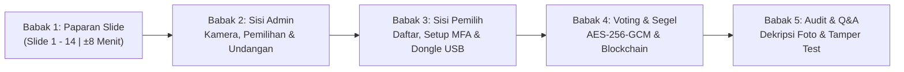

# Master Playbook: Flow Presentasi & Live Demo TrueCount

> **Proyek:** TrueCount — Secure E-Voting Akademik  
> **Mata Kuliah:** Proyek Akhir Kriptografi — S1 Informatika UPN "Veteran" Yogyakarta  
> **Estimasi Total Durasi:** 15–20 Menit (8–10 Menit Paparan Slide + 8–10 Menit Live Demo + Tanya Jawab)

---

## 1. Checklist Persiapan Teknis (H-5 Menit Sebelum Maju)

Pastikan seluruh komponen berikut siap sebelum memulai presentasi agar demonstrasi berjalan mulus tanpa kendala jaringan maupun perangkat keras:

1. **Jaringan Lokal Mandiri (Hotspot HP):**
   - Gunakan *tethering* dari satu ponsel untuk menghubungkan laptop server dan laptop/perangkat pemilih. Hindari Wi-Fi publik kampus karena fitur *AP Isolation* sering memblokir komunikasi antar-perangkat di jaringan lokal.
2. **Konfigurasi Environment Server (`.env`):**
   - Pastikan `DB_HOST=127.0.0.1` (bukan `localhost`) pada `.env` maupun `%APPDATA%\com.truecount.app\.env` agar koneksi MySQL merespons cepat tanpa jeda resolusi IPv6.
   - Pastikan PHP 8.1+ tersedia di `PATH` sistem dan layanan MySQL 8 dalam keadaan aktif.
3. **Pengaturan Dua Perangkat / Dua Jendela:**
   - **Perangkat 1 (Admin / Server):** Jalankan aplikasi desktop Tauri mode **Server** (`0.0.0.0:8000`) dalam kondisi siap di halaman `/masuk`.
   - **Perangkat 2 (Pemilih / Client):** Jalankan aplikasi desktop Tauri mode **Client** yang diarahkan ke alamat IP LAN Perangkat 1 (misal `http://192.168.x.x:8000`).
4. **Perangkat Keras & Aplikasi Latar:**
   - Siapkan **1 buah flashdisk biasa** untuk demonstrasi pembuatan dan autentikasi **Dongle USB** secara langsung.
   - Pastikan aplikasi lain yang mengakses webcam (Zoom, OBS, Camera bawaan OS) sudah ditutup sepenuhnya.
   - Siapkan tab database manager (phpMyAdmin / DBeaver / HeidiSQL) pada tabel `voters`, `ballots`, `blocks`, dan `auth_attempts` untuk pembuktian kriptografi saat sesi tanya jawab.

---

## 2. Pembagian Estafet Penyaji

Pembagian alur bicara disusun berdasarkan modul pengembangan masing-masing anggota tim agar penyampaian terasa natural dan menguasai detail teknis:

| Sesi | Penyaji | Cakupan Materi Slide (14 Slide) | Bagian Live Demo |
| :--- | :--- | :--- | :--- |
| **Bagian 1** | **Rio Meidi Ataurrahman** | Pembukaan & Pembagian Modul (Slide 1–2), Arsitektur Sistem (Slide 3), Biometrik Windows Hello & Dongle USB (Slide 9–10), Desktop Tauri v2 (Slide 13) | **Babak 1 & 2:** Gerbang kamera, registrasi undangan, setup & login Dongle USB |
| **Bagian 2** | **Muhamad Ifsal Fadhilah** | Flow Pemakaian End-to-End (Slide 4), Pilar Utama Sistem (Slide 5), Desain Database 0 Foreign Key (Slide 11) | **Babak 3:** Manajemen pemilihan admin & pencoblosan rahasia 1x suara |
| **Bagian 3** | **Erlan Rifqi Davin D** | Peta 8 Algoritma Kriptografi (Slide 6), Enkripsi Teks & Media/Steganografi (Slide 7–8), Audit Blockchain SHA-256 (Slide 12), Penutup (Slide 14) | **Babak 3 & 4:** Seal & verify blockchain, halaman `/dev`, audit log & *tamper test* |

---

## 3. Gambaran Besar Alur Presentasi & Demo

---

## 4. Panduan Paparan Slide Deck (Slide 1 – 14)

### Slide 1 — Sampul: *Suara kamu terhitung.*
- **Visual:** Ilustrasi tangan pop-art kuning-hitam dengan 3 metrik utama (`100% AES-256-GCM`, `0 FK Anonimitas Suara`, `8 Lapis Kriptografi Aktif`).
- **Poin Tekanan:** Perkenalkan identitas TrueCount sebagai platform *e-voting* akademik yang menyeimbangkan verifikasi identitas berlapis dengan anonimitas penuh pada surat suara.

### Slide 2 — Perkenalan & Pembagian Tugas Tim
- **Visual:** Tiga kartu modul kolaboratif dalam arsitektur monorepo terpadu (`React 19`, `Tauri v2`, `PHP 8.1+ Native`, `MySQL 8`).
- **Poin Tekanan:** Sebutkan tanggung jawab spesifik tiap anggota tim pada modul Autentikasi & Tauri, Sistem Pemilihan & Privasi DB, serta Kriptografi & Audit Blockchain.

### Slide 3 — Tech Stack & Arsitektur Sistem
- **Visual:** Empat lapisan teknologi dan alur komunikasi `React 19/Tauri WebView` $\rightarrow$ `JSON REST API (Bearer JWT)` $\rightarrow$ `PHP Crypto Services` $\rightarrow$ `MySQL + Encrypted Media`.
- **Poin Tekanan:** Tekankan peran **Tauri v2 (Rust)** sebagai jembatan pembacaan hardware Dongle USB ECDSA P-256 sekaligus orkestrator otomatis server PHP lokal.

### Slide 4 — Flow Pemakaian dari Undangan hingga Hasil
- **Visual:** 4 langkah utama (`01. Registrasi Undangan Token`, `02. Masuk & Setup Kamera/MFA`, `03. Pemungutan Bilik Suara`, `04. Rekap & Seal Blockchain`) disertai jalur Pemilih dan Panitia.
- **Poin Tekanan:** Jelaskan bahwa siklus pemilihan berjalan tertutup berbasis undangan dan setiap tahapannya dikunci secara kriptografis.

### Slide 5 — Tiga Pilar Utama & Halaman Pengembang (`/dev`)
- **Visual:** Tiga pilar utama (*Autentikasi Berlapis*, *Enkripsi Data & Media*, *Audit & Blockchain*) serta sorotan fitur halaman `/dev`.
- **Poin Tekanan:** Perkenalkan halaman pengembang interaktif (`/dev`) yang menyediakan simulasi langsung di dalam aplikasi untuk menguji AES-GCM, ChaCha20, Vigenere, LSB, dan Blockchain.

### Slide 6 — Peta 8 Metode Kriptografi di Dalam Aplikasi
- **Visual:** Tabel spesifikasi 8 algoritma yang bekerja sesuai fungsinya (`AES-256-GCM`, `ChaCha20-Poly1305`, `Argon2id`, `ECDSA P-256`, `PBKDF2-HMAC-SHA256`, `JWT HS256 & SHA-256`, `Vigenere & LSB PNG`).
- **Poin Tekanan:** Kelompokkan penyampaian agar ringkas: kelompok enkripsi AEAD, kelompok autentikasi/kunci, serta kelompok audit & kriptografi klasik/citra.

### Slide 7 — Enkripsi Teks Surat Suara & Pesan Rahasia
- **Visual:** Alur 4 langkah AEAD (`Payload Pilihan` $\rightarrow$ `Generate Nonce Acak` $\rightarrow$ `Ciphertext + Auth Tag` $\rightarrow$ `Simpan ke MySQL`) untuk AES-256-GCM, ChaCha20-Poly1305, dan Vigenere Cipher.
- **Poin Tekanan:** Jelaskan bahwa pilihan kandidat dienkripsi dengan kunci $256\text{-bit}$, *nonce* unik $12\text{-byte}$, *authentication tag* $16\text{-byte}$, dan `integrity_hash` sehingga anti-ubah.

### Slide 8 — Enkripsi File Gambar & Steganografi Media
- **Visual:** Penjelasan proteksi media privat pada foto audit login & kandidat (**AES-256-GCM**), pesan suara admin (**ChaCha20-Poly1305**), dan steganografi **LSB PNG**.
- **Poin Tekanan:** Tegaskan bahwa seluruh file foto dan audio disimpan di luar direktori publik web dan hanya didekripsi dinamis lewat endpoint API ber-JWT.

### Slide 9 — Biometrik Windows Hello Berbasis WebAuthn
- **Visual:** 4 langkah autentikasi tanpa sandi (`01. Challenge Acak` $\rightarrow$ `02. Sensor Lokal TPM` $\rightarrow$ `03. Foto Wajah Kamera Aktif` $\rightarrow$ `04. Terbit JWT`).
- **Poin Tekanan:** Data sidik jari/wajah tidak pernah meninggalkan chip TPM perangkat; server hanya menyimpan `credential_id`, kunci publik, dan memvalidasi `sign_count` untuk mencegah *replay attack*.

### Slide 10 — Cara Kerja Dongle USB Kriptografis
- **Visual:** 3 tahap pembentukan & penggunaan token fisik di flashdisk (`Pembangkitan Kunci di Rust`, `Enkripsi PIN PBKDF2`, `Deteksi Otomatis & Challenge-Response`).
- **Poin Tekanan:** Kunci privat **ECDSA P-256** dibangkitkan lokal di Rust dan dienkripsi memakai kunci turunan PIN (**PBKDF2-HMAC-SHA256** $100.000$ iterasi) ke berkas tersembunyi `.truecount_token`. Mencuri file tanpa PIN tetap tidak berguna.

### Slide 11 — Desain Database Tanpa Tautan Identitas Suara (`0 Foreign Key`)
- **Visual:** Perbandingan terputus antara tabel partisipasi `voters` (`user_id`, `election_id`, `has_voted = 1`) dan tabel surat suara `ballots` (`encrypted_vote`, `nonce`, `auth_tag`, `integrity_hash`).
- **Poin Tekanan:** Kedua operasi dijalankan dalam satu transaksi atomik ACID, namun relasi kolom identitas pemilih dan pilihan suara diputus total demi menjamin asas rahasia.

### Slide 12 — Penguncian Hasil Memakai Blockchain SHA-256
- **Visual:** Diagram rantai blok dari `Blok #0 (Genesis)` $\rightarrow$ `Blok #1 (Pemilihan 1)` $\rightarrow$ `Blok #2 (Pemilihan 2)` beserta mekanisme *Seal* dan *Verify*.
- **Poin Tekanan:** Saat pemilihan ditutup (`POST /elections/blockchain/seal`), sistem menghitung **Merkle Root** dari seluruh surat suara terenkripsi. Perubahan 1 baris suara di database langsung mengubah Merkle Root dan memutus validitas rantai.

### Slide 13 — Aplikasi Desktop Tauri v2 Lintas Perangkat
- **Visual:** Tiga mode operasional (**Mode Client**, **Mode Server**, **Mode Standalone**) dan keunggulan WebView Native ($\approx 6\text{–}15\text{ MB}$).
- **Poin Tekanan:** Laptop panitia otomatis menyalakan server PHP `0.0.0.0:8000` saat aplikasi dibuka, sementara PC bilik suara terhubung lewat LAN tanpa instalasi PHP maupun konfigurasi HTTPS lokal untuk akses kamera.

### Slide 14 — Penutup & Transisi Live Demo
- **Visual:** Layar penutup resmi proyek akhir informatika.
- **Poin Tekanan:** Tutup paparan slide dengan kalimat transisi singkat dan langsung beralih ke jendela aplikasi untuk demonstrasi langsung.

---

## 5. Skenario Live Demo Kronologis (4 Babak)

Alur demonstrasi dirancang berurutan dari persiapan panitia hingga audit akhir agar penguji dapat melihat keterkaitan antar-fitur secara utuh tanpa bolak-balik login.

### Babak 1: Sisi Admin — Gerbang Kamera & Persiapan Pemilihan ($\pm 2\text{ Menit}$)
1. **Uji Gerbang Kamera (`/masuk` di Perangkat 1):**
   - Tutup lensa webcam dengan jari/penutup selama 2 detik untuk menunjukkan bahwa sistem mendeteksi *frame* gelap/seragam dan memblokir tombol masuk.
   - Buka lensa hingga indikator kamera aktif, lalu masuk sebagai `admin` menggunakan **Windows Hello** (atau kata sandi).
2. **Buat Pemilihan & Kandidat (`/dasbor`):**
   - Buat pemilihan baru (misal: *"Pemilihan Ketua Himpunan Informatika 2026"*) dengan status **Aktif**.
   - Tambahkan **2 kandidat** beserta unggah foto profil (jelaskan bahwa foto langsung dienkripsi biner dengan **AES-256-GCM** ke folder privat server).
3. **Terbitkan Undangan Pemilih:**
   - Buat 1 undangan baru dengan peran `voter` dan salin tautan `/daftar?undangan=<token>`.
   - *(Opsional)* Buka `/daftar` tanpa token untuk membuktikan penolakan pendaftaran publik.

### Babak 2: Sisi Pemilih — Registrasi Undangan & Dongle USB Live ($\pm 3\text{ Menit}$)
4. **Registrasi Akun Baru (`/daftar?undangan=...` di Perangkat 2):**
   - Tempel tautan undangan, buat akun baru (misal `mahasiswa1`). Jelaskan bahwa kata sandi di-hash dengan **Argon2id** dan token undangan langsung hangus.
5. **Pengujian *Mandatory Security Setup* (`/atur-keamanan`):**
   - Login awal sebagai `mahasiswa1` untuk menunjukkan bahwa akses dasbor ditahan sebelum pengguna mendaftarkan **Windows Hello** atau **Dongle USB**.
6. **Buat & Daftarkan Dongle USB Secara Langsung:**
   - Colokkan flashdisk ke laptop $\rightarrow$ klik buat token USB $\rightarrow$ pilih drive flashdisk dan masukkan PIN (misal `123456`).
   - Jelaskan proses Rust membangkitkan kunci **ECDSA P-256** dan mengenkripsinya dengan **PBKDF2 + AES-256-GCM** ke `.truecount_token`.
   - Daftarkan kunci publik USB ke akun lewat protokol *challenge-response* $32\text{-byte}$.
7. **Uji Login dengan Dongle USB (`/masuk`):**
   - Keluar (*logout*), lalu masuk kembali memakai **Dongle USB** + PIN + kamera aktif hingga masuk ke `/dasbor`.

### Babak 3: Pencoblosan Rahasia & Segel Blockchain ($\pm 2,5\text{ Menit}$)
8. **Kirim Surat Suara Terenkripsi (`/pilih` di Perangkat 2):**
   - Pilih salah satu kandidat dan kirim suara.
   - Jelaskan bahwa pilihan dienkripsi **AES-256-GCM** (*nonce* $12\text{-byte}$, *tag* $16\text{-byte}$) dan masuk ke tabel `ballots` **tanpa Foreign Key** ke identitas pemilih.
   - Akses ulang `/pilih` untuk membuktikan validasi `has_voted = 1` mencegah pemilihan ganda.
9. **Tutup Pemilihan & Segel Blockchain (`/hasil/:id` di Perangkat 1 Admin):**
   - Ubah status pemilihan menjadi **Selesai (Closed)**, buka halaman hasil, lalu tekan tombol **Seal Blockchain** untuk membentuk blok hasil baru dan **Verify** untuk memverifikasi integritas rantai.

### Babak 4: Pembuktian Audit & Kriptografi untuk Tanya Jawab ($\pm 2\text{ Menit}$)
10. **Audit Forensik Log Keamanan (`/log-keamanan/:id`):**
    - Buka riwayat log keamanan pengguna `mahasiswa1` di akun Admin untuk menunjukkan catatan waktu, IP, metode login, serta foto wajah yang didekripsi dinamis lewat API ber-JWT.
11. **Eksplorasi Halaman Developer (`/dev`) & Media Terenkripsi:**
    - Buka `/dev` untuk mendemonstrasikan simulasi interaktif AES-GCM, ChaCha20, Vigenere, Steganografi LSB PNG, dan Blockchain (atau pesan suara admin terenkripsi ChaCha20-Poly1305 bila ditanyakan).
12. **Trik Pamungkas — Simulasi Manipulasi Data (*Tamper Test*):**
    - Tampilkan tabel `ballots` di database manager untuk membuktikan tidak ada kolom `user_id` dan seluruh suara berwujud *ciphertext*.
    - Ubah 1 karakter pada kolom `encrypted_vote` di salah satu baris `ballots`, lalu tekan kembali tombol **Verify** pada halaman `/hasil/:id` — aplikasi akan langsung mendeteksi ketidaksesuaian Merkle Root dan memperingatkan bahwa rantai blok telah dimanipulasi.

---

## 6. Bank Jawaban Q&A Dosen Penguji

| Pertanyaan yang Sering Diajukan Dosen | Poin Jawaban Teknis yang Kuat |
| :--- | :--- |
| **"Bagaimana kalian menjamin kerahasiaan suara jika admin memegang akses penuh ke database?"** | Kami menerapkan pemisahan relasi (*0 Foreign Key*). Tabel `voters` hanya mencatat partisipasi (`has_voted = 1`), sedangkan tabel `ballots` menyimpan *ciphertext* suara AES-256-GCM **tanpa kolom `user_id` maupun `voter_id`**. Tidak ada relasi teknis yang dapat menghubungkan siapa memilih siapa. |
| **"Mengapa memakai dua algoritma enkripsi simetris sekaligus (AES-256-GCM dan ChaCha20-Poly1305)?"** | Keduanya adalah standar AEAD modern. **AES-256-GCM** digunakan untuk surat suara, foto audit, foto kandidat, dan kunci USB karena memanfaatkan akselerasi hardware AES-NI, sedangkan **ChaCha20-Poly1305** digunakan untuk pesan rahasia dan rekaman suara admin karena performa *stream cipher*-nya sangat cepat dan konsisten di berbagai perangkat. |
| **"Flashdisk biasa mudah disalin isinya. Bagaimana keamanan Dongle USB-nya?"** | File `.truecount_token` hanya menyimpan *private key* **ECDSA P-256** dalam kondisi terenkripsi **AES-256-GCM** dengan kunci yang diturunkan dari PIN pengguna melalui **PBKDF2-HMAC-SHA256** ($100.000$ iterasi). Tanpa PIN rahasia, salinan file tidak dapat mendekripsi kunci privat untuk menandatangani *challenge* acak $32\text{-byte}$ dari server. |
| **"Bagaimana sistem mencegah kecurangan memakai foto statis atau menutup kamera saat login?"** | Sistem memvalidasi distribusi piksel pada `<canvas>` secara *real-time* untuk menolak *frame* gelap pekat maupun lensa tertutup (*privacy shutter*), serta menyimpan bukti foto terenkripsi ke dalam log audit admin sebagai pertanggungjawaban visual setiap percobaan masuk. |
| **"Mengapa memilih Tauri v2 dibanding Electron untuk aplikasi desktopnya?"** | Tauri v2 menggunakan inti bahasa **Rust** dan *WebView* bawaan OS, sehingga ukuran aplikasi sangat ringan ($\approx 6\text{–}15\text{ MB}$), mampu membaca perangkat keras USB secara native, dan dapat menjalankan/mematikan server PHP lokal secara otomatis tanpa membuka jendela terminal. |

---

## 7. Rencana Cadangan (Mitigasi Risiko Saat Demo)

- **Jika koneksi LAN antar-laptop terhambat:** Jalankan demo penuh pada **1 laptop** dalam mode **Standalone** (`127.0.0.1:8000`) menggunakan aplikasi desktop untuk Pemilih + jendela browser untuk Admin.
- **Jika webcam sedang terkunci proses lain:** Gunakan tombol ganti kamera di halaman `/masuk` untuk beralih ke perangkat kamera sekunder, atau tutup paksa proses yang memakai kamera lewat Task Manager.
- **Jika file token USB sebelumnya masih tertinggal di flashdisk:** Gunakan opsi timpa token lama saat membuat token baru di aplikasi, atau hapus file tersembunyi `.truecount_token` di root flashdisk sebelum demo dimulai.