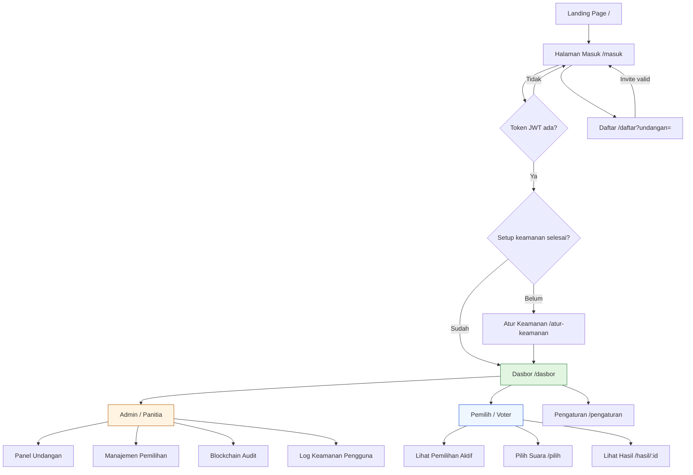
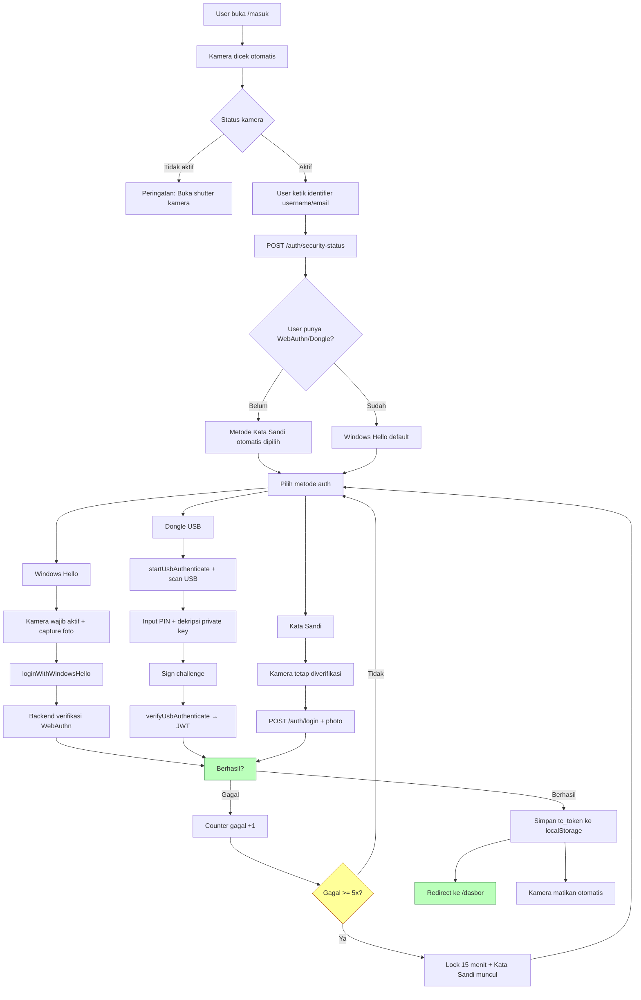
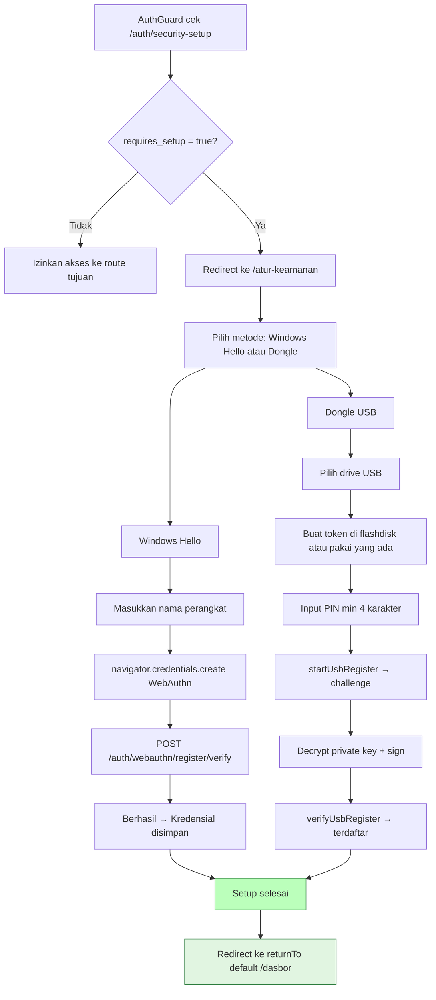
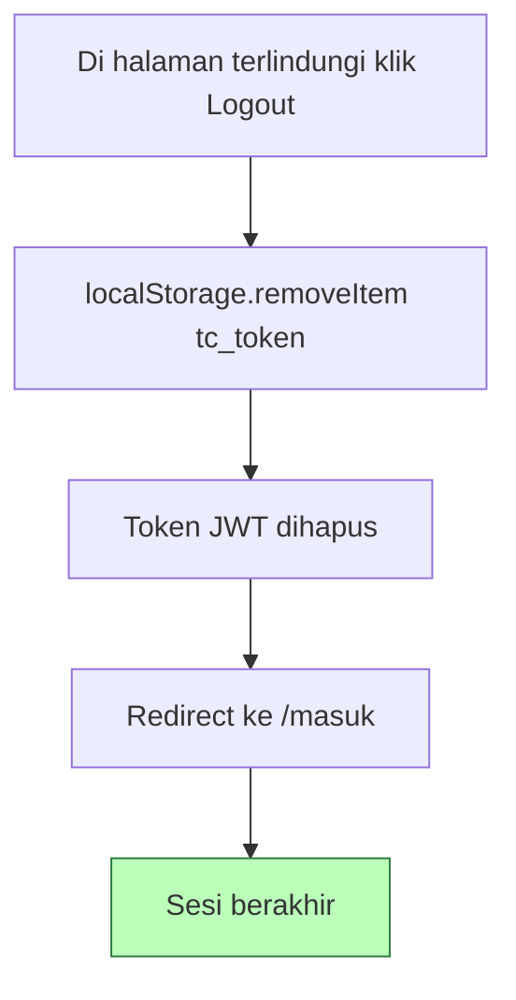

# TrueCount - Flow Pengguna (User Flow)

> Dokumen ini menjelaskan alur lengkap penggunaan aplikasi TrueCount dari awal hingga akhir, dibedakan per peran pengguna. Untuk konteks teknis AI/developer, lihat [`knowledge_transfer.md`](knowledge_transfer.md).

---

## 1. Ringkasan Alur Umum (Semua Pengguna)

```
Landing Page (/) 
    → /masuk (Login) 
    → [belum setup keamanan?] → /atur-keamanan (Security Setup) 
    → /dasbor (Dashboard)
```

Setelah login dan setup keamanan selesai, pengguna dapat mengakses halaman terlindungi sesuai perannya.

---

## 2. Alur Calon Pengguna (Pemilih Baru)

Pendaftaran publik **ditutup**. Akun baru hanya bisa dibuat lewat tautan undangan yang dibuat admin.

### Langkah demi langkah:

```
Admin buat undangan di /dasbor
    → dapat tautan /daftar?undangan=<token>
    → bagikan ke calon pengguna
Calon pengguna buka tautan undangan
    → RegisterPage verifikasi token via GET /invites/verify
    → [token valid] tampilkan form pendaftaran
    → [token invalid/kedaluwarsa] tampilkan error "Undangan tidak berlaku"
Isi form (username, email, password)
    → POST /auth/register dengan invite_token
    → berhasil → redirect ke /masuk + notifikasi "Akun berhasil dibuat"
Login via /masuk (lihat bagian 3)
```

### Detail halaman register (`/daftar`):

| Kondisi | Tampilan |
|---------|----------|
| Belum ada token `?undangan=` | State "Pendaftaran hanya melalui undangan" + tombol Masuk |
| Token sedang dicek | Skeleton loading |
| Token tidak valid / kedaluwarsa | Error "Undangan tidak berlaku" + tombol Masuk |
| Token valid | Form pendaftaran (username, email, password, konfirmasi) |

- Email otomatis diisi dan dikunci jika undangan terikat email
- Password minimal 8 karakter
- Role akun mengikuti role di undangan (`voter` default, admin bisa undang admin)

---

## 3. Alur Login (`/masuk`)

Halaman login menampilkan **3 metode auth**, tersedia sesuai kondisi perangkat dan user:

| Metode | Ikon | Keterangan | Kapan tersedia |
|--------|------|------------|----------------|
| **Windows Hello** | 👆 Sidik jari | Sidik jari, wajah, atau PIN Windows (kamera wajib aktif) | Default, jika kamera aktif & WebAuthn supported |
| **Dongle USB** | 🔑 Kunci | USB token fisik (TrueCount Token), ECDSA P-256 | Hanya di app desktop (Tauri) |
| **Kata Sandi** | 🔒 Kunci | Username/email + password | Saat onboarding, setelah 5x gagal, atau kamera tidak tersedia |

### Detail proses login:

```
1. Kamera dicek otomatis (useCameraPermission)
   - Titik indikator berkedip hijau ↔ abu-abu selama verifikasi
   - User dapat mencapture foto ulang sebelum auth dikirim
2. User ketik identifier (username atau email)
3. Frontend POST /auth/security-status
   - Belum punya WebAuthn/Dongle → identifierNeedsSetup = true
   - Metode Kata Sandi otomatis dipilih (onboarding)
4. User pilih metode:
   a. Windows Hello:
      - Kamera wajib aktif (canvas sampling, verifikasi frame tidak gelap/shutter)
      - Ambil foto kamera (auth_photo)
      - loginWithWindowsHello(identifier, photo)
      - Success → JWT diterima → navigate /dasbor
   b. Dongle USB (Tauri only):
      - startUsbAuthenticate(identifier) → dapatkan challenge
      - Scan USB otomatis (polling tiap 2 detik)
      - Input PIN → dekripsi private key dari USB
      - Sign challenge → verifyUsbAuthenticate(challenge_id, signature, photo)
      - Success → JWT diterima → navigate /dasbor
   c. Kata Sandi:
      - Kamera tetap diverifikasi aktif
      - POST /auth/login + auth_photo
      - Success → JWT diterima → navigate /dasbor
5. Setiap percobaan (sukses/gagal) di-log ke DB auth_attempts oleh backend
   - Termasuk foto kamera, IP, user_agent, method
6. Gagal 5x → lock 15 menit → Kata Sandi otomatis muncul (emergency fallback)
7. Berhasil → simpan tc_token ke localStorage → navigate /dasbor
8. Kamera matikan otomatis saat meninggalkan halaman login
```

### Status indikator kamera (`status-dot`):

- Warna **hijau `#2a7a3b`** ↔ **abu-abu `#9ca3af`**, berkedip setiap 1,5 detik
- File CSS: `frontend/src/pages/AuthPage.css`
- `prefers-reduced-motion: reduce` → animasi dimatikan, titik tetap hijau statis

---

## 4. Alur Setup Keamanan Wajib (`/atur-keamanan`)

Sebelum mengakses halaman terlindungi (`/dasbor`, `/pilih`, `/pengaturan`, dll.), `AuthGuard` memeriksa `GET /auth/security-setup`. Jika `requires_setup = true`, user diarahkan ke halaman ini dengan `returnTo` disimpan.

Pilih **minimal satu** metode:

### A. Windows Hello (WebAuthn)
```
Pilih "Windows Hello"
    → Masukkan nama perangkat (contoh: "Laptop Kantor")
    → Browser meminta autentikasi WebAuthn (Face ID / Windows Hello / PIN)
    → Kamera wajib aktif
    → Kredensial disimpan di biometric_credentials
    → Berhasil → redirect ke returnTo (default /dasbor)
```

### B. Dongle Keamanan (USB Token)
```
Pilih "Dongle Keamanan"
    → Pilih drive USB yang terdeteksi (scan otomatis tiap 2 detik)
    → Buat token baru di flashdisk atau pilih token yang sudah ada
    → Masukkan PIN (min. 4 karakter)
    → Sign challenge → verifikasi di backend /mfa/usb/register/*
    → Token terdaftar ke akun user
    → Berhasil → redirect ke returnTo (default /dasbor)
```

---

## 5. Alur Admin / Panitia (`/dasbor`)

Setelah login dan setup keamanan, admin melihat dashboard dengan 4 panel utama:

### A. Panel Undangan (Referral Pendaftaran)

```
Lihat statistik: total, menunggu, diterima, kedaluwarsa, dibatalkan
    → Buat undangan baru: isi email (opsional) + peran (voter/admin)
    → Dapatkan tautan /daftar?undangan=<token>
    → Salin tautan & bagikan ke calon pemilih
    → Batalkan undangan yang masih status menunggu
Undangan otomatis kedaluwarsa setelah 7 hari (INVITE_EXPIRE_DAYS di .env)
```

### B. Panel Manajemen Pemilihan (Election Management)

```
Buat pemilihan baru: judul, deskripsi, waktu mulai, waktu selesai, status
    → Kelola kandidat: tambah, ubah, hapus paslon + upload foto (terenkripsi)
    → Tentukan peserta pemilih: daftarkan voter tertentu ke pemilihan
    → Ubah status: Draft → Aktif (buka voting) → Selesai (tutup & siap hitung)
    → Hapus pemilihan: hanya jika masih status draft
```

Status pemilihan:

| Status | Label | Artinya |
|--------|-------|---------|
| `draft` | Draft | Belum dibuka untuk voting |
| `active` | Aktif | Sedang voting berlangsung |
| `closed` | Selesai | Hasil tersedia, bisa di-seal |

### C. Blockchain Audit

```
Pilih pemilihan yang sudah Selesai (closed)
    → Seal: cetak blok blockchain dengan merkle root dari semua suara
    → Verify: periksa integritas rantai blockchain (tidak boleh diubah)
```

### D. Log Keamanan Pengguna (Audit Admin)

```
Cari pengguna via /users/search (username atau email)
    → Klik user → lihat riwayat percobaan login di /log-keamanan/:id
Setiap baris log menampilkan:
    - Waktu, Metode (Windows Hello / Dongle / Kata Sandi)
    - Status (Berhasil / Gagal), IP Address, Keterangan error
    - Foto kamera (bisa diperbesar via lightbox)
Hanya admin yang bisa akses halaman ini
```

---

## 6. Alur Pemilih Terdaftar (Voter) — Memilih Suara

### 6.1 Di Dashboard (`/dasbor`, tampilan voter)

- Lihat daftar pemilihan yang aktif dan terdaftar di akunnya
- Status tiap pemilihan:
  - **Belum Memilih** (merah)
  - **Pilihan Tersimpan (Belum Diinput)** (biru)
  - **Sudah Memilih** (hijau)

### 6.2 Di Halaman Pemilihan (`/pilih`)

```
Pilih salah satu pemilihan aktif
    → Lihat daftar kandidat dengan foto, visi, misi
    → Klik kartu kandidat untuk memilih (pilihan tersimpan sebagai draft di localStorage)
    → Bisa mengubah pilihan kapan saja sebelum menekan tombol final
    → Klik "Input Suara" → konfirmasi dialog
    → Suara dikirim via POST /elections/:id/vote
    → Suara dienkripsi (AES-256-GCM), tidak ada FK ke user (privasi by design)
    → Setelah sukses → halaman konfirmasi "Suara kamu telah berhasil diinput"
    → Tidak bisa memilih lagi pada pemilihan yang sama (has_voted = true)
```

### 6.3 Lihat Hasil (`/hasil/:id`)

- Total suara, jumlah pemilih terdaftar, persentase partisipasi
- Daftar hasil per kandidat dengan bar progres dan persentase
- Pemilihan yang **Selesai** menampilkan pemenang dengan badge "Pemenang"

---

## 7. Alur Pengaturan Akun (`/pengaturan`)

Terdapat 3 tab:

### Tab Password
- Ubah kata sandi lama → baru (min. 8 karakter), hash dengan Argon2id

### Tab Windows Hello (WebAuthn)
- Lihat daftar Windows Hello yang sudah terdaftar
- Daftarkan baru (memunculkan dialog Windows Hello di perangkat)
- Hapus kredensial yang tidak diperlukan

### Tab USB Token (MFA)
- Lihat daftar USB token terdaftar (aktif/nonaktif)
- **Buat Token di USB baru:** pilih drive flashdisk, buat PIN, file token dibuat di flashdisk
- **Daftarkan USB Baru:** scan flashdisk → input PIN → sign challenge → ikat ke akun
- Ubah label token / Nonaktifkan token

---

## 8. Alur Logout

- Di semua halaman terlindungi ada tombol **Logout** di nav bar
- `localStorage.removeItem('tc_token')` → redirect ke `/masuk`
- Token JWT dihapus, sesi berakhir

---

## 9. Ringkasan Route & Akses

| Path | Siapa yang Akses | Keterangan |
|------|-----------------|------------|
| `/` | Semua | Landing page |
| `/tentang` | Semua | Info proyek & tim |
| `/masuk` | Semua | Login (3 metode auth) |
| `/daftar?undangan=...` | Punya undangan | Register invite-only |
| `/atur-keamanan` | Belum setup | Setup Windows Hello / Dongle wajib |
| `/dasbor` | Login + setup | Dashboard (admin atau voter) |
| `/pilih` | Login + setup | Halaman voting |
| `/hasil/:id` | Login + setup | Lihat hasil pemilihan |
| `/pengaturan` | Login + setup | Kelola password, WebAuthn, USB token |
| `/usb-token-test` | Login + setup | Test USB token |
| `/pesan-terenkripsi` | Login + setup | Buat/lihat pesan terenkripsi |
| `/log-keamanan/:id` | Admin only | Audit log login + foto kamera |
| `/dev` | Admin + Dev | Halaman dev - visualisasi flow & kriptografi (3D isometrik) |

Alias lama (`/login`, `/register`, `/dashboard`) redirect otomatis ke path baru.

---

## 10. Fitur Keamanan Penting dalam Flow

| Fitur | Deskripsi |
|-------|-----------|
| Pendaftaran hanya via undangan | Tidak ada register bebas, wajib `invite_token` |
| Setup keamanan wajib | Tidak bisa masuk dashboard sebelum pasang Windows Hello atau Dongle |
| Kamera wajib aktif | Untuk Windows Hello dan kata sandi; verifikasi frame tidak gelap/shutter tertutup |
| Foto kamera sebagai audit | Ditangkap sebelum setiap percobaan login, disimpan di `auth_attempts.photo_path` |
| Lockout 15 menit | Setelah 5x percobaan gagal, kata sandi muncul sebagai emergency fallback |
| Suara anonIM | `ballots` tidak punya FK ke `users` (privasi by design) |
| Blockchain seal/verify | Integritas hasil pemilihan |
| Auto-session management | Cek expiry JWT tiap 30 detik, auto-logout jika expired atau 401 |

---

## 11. Halaman Dev (`/dev`) — Admin + Developer

Halaman dev eksklusif untuk role `admin` dan `dev`, berisi visualisasi 3D isometrik interaktif sebagai dokumentasi teknis dan materi pitch deck.

### Akses
- URL: `/dev` (diakses setelah login + setup keamanan)
- Role yang diizinkan: `admin`, `dev` (dicek oleh `RoleGuard` di frontend dan `requireDevOrAdmin()` di backend middleware)
- User dev default: `dev` / `Dev@1234` (seed `003_dev_user.sql`)

### Dua Section Visualisasi 3D Isometrik

#### A. Flow Aplikasi
Menampilkan alur lengkap aplikasi dari awal hingga akhir sebagai blok 3D isometrik:
1. **Pengguna** → membuka aplikasi
2. **Login / Masuk** → 3 metode: Windows Hello, Dongle USB, Kata Sandi
3. **Setup Keamanan** → wajib setup Windows Hello atau Dongle sebelum akses dasbor
4. **Dasbor** → Admin (undangan, pemilihan, blockchain audit) | Pemilih (daftar pemilihan aktif)
5. **Input Suara** → Pemilih memilih kandidat, suara dienkripsi AES-256-GCM
6. **Hasil + Blockchain** → tally suara + verifikasi integritas blockchain

Warna per peran: 🟠 Admin = Oranye, 🔵 Pemilih = Biru, 🟢 Sistem = Hijau. Klik node untuk lihat detail.

#### B. Algoritma Kriptografi
Menampilkan 8 algoritma kriptografi sebagai blok 3D dengan ikon:
| Algoritma | Digunakan Untuk |
|-----------|-----------------|
| Argon2id | Hash password |
| JWT HS256 | Token otentikasi |
| AES-256-GCM | Enkripsi suara + file |
| ChaCha20-Poly1305 | Enkripsi pesan/file |
| Vigenere | Enkripsi pesan klasik |
| Steganografi (LSB) | Sembunyikan pesan dalam gambar |
| Blockchain sederhana | Integritas hasil pemilihan |
| ECDSA P-256 | USB Token / WebAuthn signature |

Klik algoritma untuk lihat detail implementasi (file PHP, ukuran key, mode operasi).

### Catatan
- Halaman dev bersifat **read-only**, tidak mengubah data produksi.
- Semua akses ke halaman dev dicatat untuk audit.
- Cocok sebagai materi presentasi (pitch deck) saat sidang proyek akhir.

---

## 11. Diagram Alur Pengguna (Mermaid)

Diagram di bawah ini menggunakan sintaksis **Mermaid**. Untuk melihat render visual, buka file ini di GitHub, GitLab, VS Code (dengan extension Mermaid), atau salin blok kode ke [mermaid.live](https://mermaid.live).

### 11.1 Alur Keseluruhan (Overview)



### 11.2 Alur Registrasi (Hanya Lewat Undangan)

```mermaid
flowchart TD
    A[Admin buat undangan di /dasbor] --> B[Dapatkan tautan /daftar?undangan=<token>]
    B --> C[Calon pengguna buka tautan]
    C --> D{Token valid?}
    D -- Tidak --> E[Tampilkan error "Undangan tidak berlaku"]
    D -- Ya --> F[Tampilkan form pendaftaran]
    F --> G[Isi username, email, password]
    G --> H[Klik Buat akun]
    H --> I[POST /auth/register + invite_token]
    I --> J{Berhasil?}
    J -- Tidak --> K[Tampilkan error]
    K --> G
    J -- Ya --> L[Redirect ke /masuk + notifikasi sukses]
    L --> M[Login]

    style I fill:#f9f,stroke:#333,stroke-width:2px
    style L fill:#bfb,stroke:#2a7a3b
```

### 11.3 Alur Login (`/masuk`) — 3 Metode



### 11.4 Alur Setup Keamanan Wajib (`/atur-keamanan`)



### 11.5 Alur Admin / Panitia (`/dasbor`)

```mermaid
flowchart TD
    A[Admin login & setup selesai] --> B[Dasbor /dasbor]

    B --> C[Panel Undangan]
    C --> C1[Lihat statistik undangan]
    C1 --> C2[Buat undangan baru email + peran]
    C2 --> C3[Dapatkan tautan /daftar?undangan=]
    C3 --> C4[Bagikan ke calon pemilih]
    C --> C5[Batalkan undangan menunggu]

    B --> D[Panel Manajemen Pemilihan]
    D --> D1[Buat pemilihan baru judul, waktu, status]
    D1 --> D2[Kelola kandidat tambah/ubah/hapus + foto]
    D2 --> D3[Daftarkan peserta pemilih voter]
    D3 --> D4[Ubah status draft → active → closed]

    D4 --> E{Pemilihan status closed?}
    E --> Ya[F[Panel Blockchain Audit]]
    E --> Tidak[G[Tutup pemilihan dulu]]

    F --> F1[Seal blok blockchain]
    F1 --> F2[Verify integritas rantai]

    B --> H[Log Keamanan Pengguna]
    H --> H1[Cari user via /users/search]
    H1 --> H2[Lihat log /log-keamanan/:id]
    H2 --> H3[Lihat foto kamera setiap percobaan]

    style F fill:#eef6ff,stroke:#1d4ed8
    style H fill:#fff4e1,stroke:#b45309
```

### 11.6 Alur Pemilih / Voter

```mermaid
flowchart TD
    A[Pemilih login & setup selesai] --> B[Dasbor /dasbor]

    B --> C[Lihat daftar pemilihan aktif]
    C --> D{Terdaftar di pemilihan?}
    D -- Tidak --> E[Belum ada pemilihan aktif]
    D -- Ya --> F[Pilih salah satu pemilihan /pilih]

    F --> G[Lihat daftar kandidat foto + visi + misi]
    G --> H[Klik kartu kandidat → draft tersimpan localStorage]
    H --> I{Ubah pilihan?}
    I -- Ya --> G
    I -- Tidak --> J[Klik Input Suara]

    J --> K[Konfirmasi dialog]
    K --> L[POST /elections/:id/vote]
    L --> M[Suara dienkripsi AES-256-GCM]
    M --> N[Berhasil?]

    N -- Berhasil --> O[Halaman konfirmasi "Suara berhasil diinput"]
    N -- Gagal --> P[Tampilkan error]
    P --> G

    O --> Q[Tidak bisa pilih lagi has_voted = true]
    Q --> R[Lihat hasil /hasil/:id]

    B --> S[Pengaturan /pengaturan]

    style O fill:#bfb,stroke:#2a7a3b
    style Q fill:#ff9,stroke:#b45309
    style R fill:#eef6ff,stroke:#1d4ed8
```

### 11.7 Alur Logout



---

## 12. Tabel Ringkasan Status Diagram

| Status | Warna | Keterangan |
|--------|-------|------------|
| Berhasil / Aktif | Hijau `#2a7a3b` | Proses selesai atau halaman utama |
| Proses / Menunggu | Biru `#1d4ed8` | Sedang berlangsung atau membutuhkan aksi user |
| Peringatan / Gagal | Oranye `#b45309` | Error, lockout, atau kondisi peringatan |

---

## 13. Diagram Alur Singkat (Admin vs Pemilih)

```
ADMIN:
Undangan → Buat Pemilihan → Kelola Kandidat → Daftarkan Voter → Buka Voting → Tutup → Seal Blockchain → Audit Log

PEMILIH:
Undangan → Daftar → Login → Setup Keamanan → Lihat Pemilihan → Pilih Kandidat → Input Suara → Lihat Hasil
```

---

> Dokumentasi ini sejalan dengan [`README.md`](../README.md) dan [`docs/dev/knowledge_transfer.md`](knowledge_transfer.md). Untuk detail endpoint API dan struktur file, lihat keduanya.
