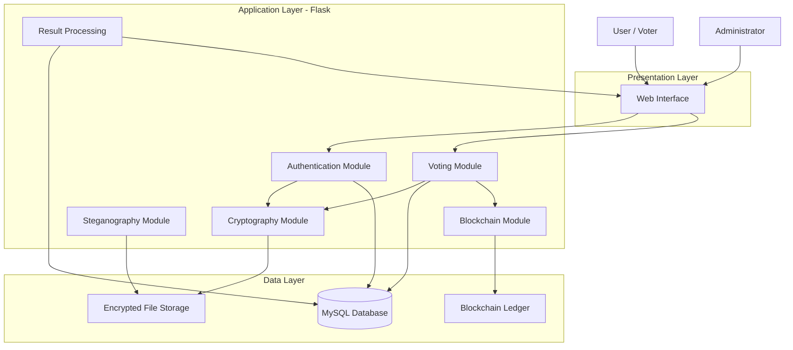
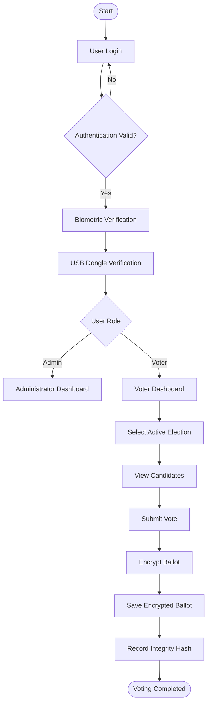
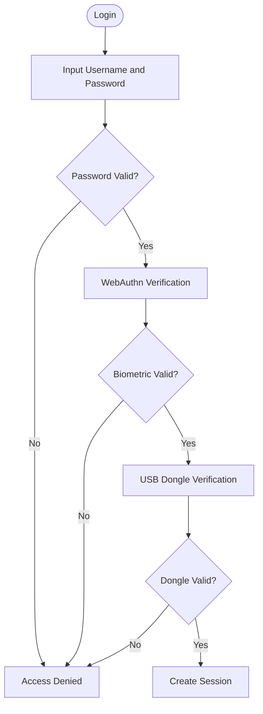
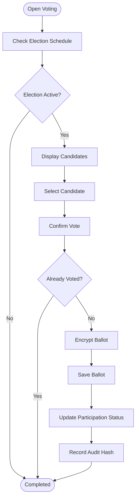
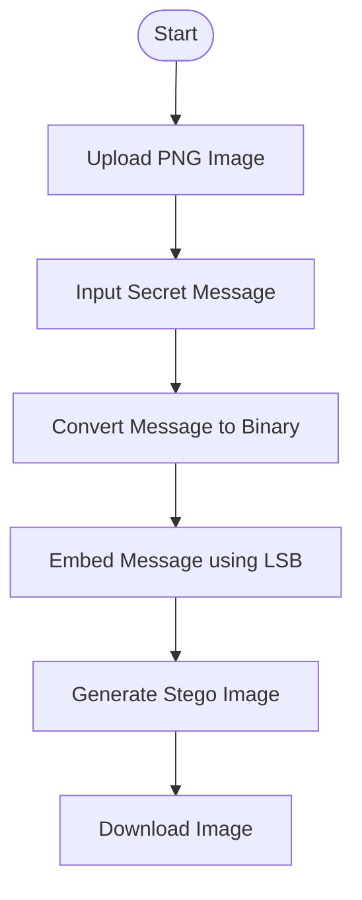
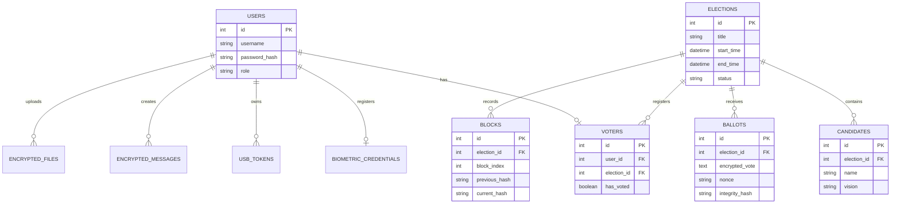

# DOCUMENT DEVELOPING
# Secure E-Voting System

**Project Type:** Web-Based Application  
**Domain:** Information Security & Cryptography  
**Backend:** Python (Flask)  
**Frontend:** HTML, CSS, JavaScript, Bootstrap  
**Database:** MySQL  
**Project Status:** Development

---

# 1. Project Overview

## 1.1 Deskripsi Proyek

**Secure E-Voting System** merupakan aplikasi pemungutan suara elektronik yang dirancang untuk membantu proses pemilihan secara digital dengan menerapkan beberapa mekanisme keamanan informasi.

Aplikasi ini dapat digunakan sebagai simulasi pemilihan ketua organisasi, ketua kelas, maupun pemilihan internal kampus.

Fokus utama proyek adalah menjaga:

- **Confidentiality:** Kerahasiaan pilihan pemilih.
- **Integrity:** Keutuhan data suara dan hasil pemilihan.
- **Authentication:** Memastikan pengguna yang mengakses sistem merupakan pengguna terdaftar.
- **Availability:** Memastikan sistem dapat digunakan selama periode pemilihan.
- **Accountability:** Menyediakan catatan aktivitas administratif yang dapat diperiksa.

Sistem akan mengintegrasikan beberapa teknologi keamanan, yaitu hashing, encryption, biometrik, USB dongle, steganografi, dan blockchain sederhana.

## 1.2 Tujuan Pengembangan

1. Membangun aplikasi pemungutan suara berbasis web.
2. Menerapkan autentikasi pengguna menggunakan password, biometrik, dan USB dongle.
3. Mengamankan data suara menggunakan algoritma kriptografi.
4. Menggunakan algoritma enkripsi yang berbeda untuk data teks dan file.
5. Menyimpan informasi penting dalam database dalam bentuk terenkripsi.
6. Mengimplementasikan steganografi untuk menyisipkan pesan ke dalam gambar.
7. Menggunakan blockchain sederhana sebagai mekanisme pencatatan integritas aktivitas pemilihan.

## 1.3 Ruang Lingkup

Aplikasi memiliki dua jenis pengguna utama:

| Role | Hak Akses |
|---|---|
| Administrator | Mengelola pemilihan, kandidat, pemilih, dan melihat hasil akhir. |
| Voter (Pemilih) | Melihat kandidat, memberikan suara, dan melihat status partisipasi. |

Fitur utama:

- Authentication & Authorization
- Biometric Authentication
- USB Dongle Verification
- Election Management
- Candidate Management
- Voting System
- Cryptographic Encryption
- Encrypted Database Storage
- Image Steganography
- Simple Blockchain
- Election Result Dashboard

---

# 2. Technology Stack

Teknologi yang digunakan dalam pengembangan proyek.

| Komponen | Teknologi | Fungsi |
|---|---|---|
| Programming Language | Python | Bahasa pemrograman utama. |
| Backend | Flask | Menangani proses aplikasi dan API. |
| Frontend | HTML, CSS, JavaScript | Membangun antarmuka pengguna. |
| UI Framework | Bootstrap | Membantu desain antarmuka. |
| Database | MySQL | Menyimpan data aplikasi. |
| Database ORM | SQLAlchemy | Mengelola interaksi database. |
| Password Hashing | Argon2id | Mengamankan password pengguna. |
| Text Encryption | Vigenere + AES-256-GCM | Demonstrasi dan pengamanan data teks. |
| File Encryption | ChaCha20-Poly1305 | Mengamankan dokumen dan file. |
| Integrity Hashing | SHA-256 | Memeriksa integritas data. |
| Biometrics | WebAuthn / Windows Hello | Autentikasi biometrik. |
| Dongle | USB Security Token | Verifikasi kepemilikan perangkat. |
| Steganography | LSB | Menyisipkan pesan ke dalam gambar. |
| Blockchain | Python Implementation | Mencatat riwayat aktivitas secara berantai. |

**Catatan implementasi:**

- Vigenere digunakan sebagai demonstrasi algoritma kriptografi klasik, bukan sebagai perlindungan suara sungguhan. AES-256-GCM digunakan untuk pengamanan sebenarnya.
- Windows Hello atau WebAuthn menangani verifikasi biometrik. Aplikasi tidak perlu menyimpan gambar sidik jari.
- Untuk prototipe, USB flash drive dapat digunakan sebagai simulasi dongle. Namun, implementasi yang lebih baik menggunakan USB security key dengan challenge-response.
- SHA-256 digunakan untuk integritas, bukan untuk menyimpan password.

---

# 3. System Architecture

## 3.1 Gambaran Arsitektur

Aplikasi menggunakan arsitektur sederhana dengan tiga bagian utama:

1. **Presentation Layer:** Antarmuka yang digunakan oleh administrator dan pemilih.
2. **Application Layer:** Menangani autentikasi, pemilihan, kriptografi, steganografi, dan blockchain.
3. **Data Layer:** Menyimpan data pengguna, kandidat, suara terenkripsi, dan catatan blockchain.

### Architecture Diagram



## 3.2 Alur Sistem Secara Umum



Catatan: Alur tersebut merupakan gambaran konseptual. Pada implementasi sebenarnya, proses autentikasi harus menggunakan mekanisme yang aman dan suara harus dipisahkan dari identitas pemilih.

---

# 4. Main Modules Development

Bagian ini menjelaskan modul yang harus dikembangkan.

## 4.1 Authentication Module

Modul ini bertanggung jawab terhadap proses login dan verifikasi identitas pengguna.

### Fitur

- Login menggunakan username dan password.
- Password disimpan menggunakan Argon2id.
- Verifikasi biometrik menggunakan WebAuthn.
- Verifikasi USB dongle.
- Pembatasan hak akses berdasarkan role.

### Authentication Flow



### Password Security

Gunakan algoritma Argon2id untuk menyimpan password.

Contoh:

```text
Password:
mySecurePassword123

        |
        v

Argon2id Hashing

        |
        v

Stored Hash:
$argon2id$...
```

Password asli tidak boleh disimpan di database.

### Biometric Authentication

Sistem menggunakan WebAuthn untuk menghubungkan aplikasi dengan authenticator pada perangkat pengguna.

Contoh authenticator:

- Windows Hello.
- Fingerprint Reader.
- Smartphone Biometric Authentication.
- FIDO2 Security Key.

Aplikasi hanya menerima hasil verifikasi kriptografis, bukan data sidik jari mentah.

### USB Dongle Verification

USB dongle berfungsi sebagai bukti bahwa pengguna memiliki perangkat yang telah didaftarkan.

Untuk implementasi awal:

1. Pengguna mendaftarkan USB token.
2. Sistem menyimpan identitas token yang sudah didaftarkan.
3. Saat login, sistem memberikan challenge acak.
4. Perangkat memberikan respons berdasarkan secret key.
5. Sistem memverifikasi respons tersebut.

Hindari hanya memeriksa nama atau serial number flashdisk karena informasi tersebut dapat ditiru.

---

## 4.2 Voting Module

Modul utama yang digunakan untuk melakukan pemungutan suara.

### Fitur

- Menampilkan daftar pemilihan aktif.
- Menampilkan kandidat.
- Memungkinkan pemilih memberikan satu suara.
- Memeriksa status pemilih.
- Mencegah pemilih memberikan suara lebih dari satu kali.
- Menyimpan ballot dalam bentuk terenkripsi.

### Voting Flow



### Aturan Voting

1. Setiap pemilih hanya boleh memberikan satu suara dalam satu pemilihan.
2. Suara yang sudah dikirim tidak dapat diubah melalui antarmuka.
3. Hasil voting hanya dapat ditampilkan setelah pemilihan ditutup.
4. Administrator tidak dapat mengubah suara yang telah masuk.
5. Sistem tidak boleh menyimpan hubungan langsung antara identitas pemilih dan isi pilihannya.

**Penting:** Data partisipasi pemilih harus dipisahkan dari tabel ballot. Jangan menyimpan `voter_id` secara langsung di dalam tabel suara. Ini merupakan langkah awal untuk menjaga kerahasiaan pilihan, meskipun belum memberikan jaminan anonimitas penuh.

---

## 4.3 Cryptography Module

Modul ini menangani proses enkripsi dan dekripsi.

### A. Text Encryption

Algoritma yang digunakan:

1. Vigenere Cipher.
2. AES-256-GCM.

Vigenere digunakan sebagai pembelajaran kriptografi klasik, sedangkan AES-256-GCM menjadi mekanisme perlindungan modern.

Contoh ilustrasi:

```text
Plaintext:
HASIL PEMILIHAN

       |
       v

Vigenere Cipher

       |
       v

Intermediate Ciphertext

       |
       v

AES-256-GCM

       |
       v

Encrypted Data
```

Untuk penggunaan sebenarnya pada ballot, gunakan AES-256-GCM secara langsung. Jangan menganggap kombinasi Vigenere dan AES otomatis lebih aman.

### B. File Encryption

Algoritma yang digunakan:

**ChaCha20-Poly1305**

Digunakan untuk mengamankan file seperti:

- Dokumen laporan pemilihan.
- Dokumen kandidat.
- Dokumen administrasi.
- File pendukung lainnya.

Alur:

```text
Original File
     |
     v
Read Binary Data
     |
     v
ChaCha20-Poly1305
     |
     v
Encrypted File
     |
     v
Save to Storage
```

Saat file akan digunakan kembali:

```text
Encrypted File
     |
     v
Decrypt Process
     |
     v
Integrity Verification
     |
     v
Original File
```

Perhatikan bahwa nonce harus unik untuk setiap proses enkripsi dengan key yang sama. Jangan pernah menggunakan kembali nonce pada key yang sama.

### C. Hashing

Algoritma:

**SHA-256**

Digunakan untuk:

- Memeriksa perubahan file.
- Membuat hash dari data ballot terenkripsi.
- Membuat hash setiap block blockchain.
- Memeriksa integritas dokumen.

Contoh:

```text
Original Data
     |
     v
SHA-256
     |
     v
64 Character Hexadecimal Hash
```

Hash bukan enkripsi dan tidak dapat digunakan untuk mengembalikan data asli.

---

## 4.4 Database Encryption Module

Modul ini bertanggung jawab untuk menjaga informasi penting yang tersimpan di MySQL.

### Data yang perlu diamankan

| Data | Mekanisme |
|---|---|
| User Password | Argon2id |
| Ballot | AES-256-GCM |
| Pesan Administrasi | AES-256-GCM |
| File Administrasi | ChaCha20-Poly1305 |
| Hash Integritas | SHA-256 |

### Contoh penyimpanan

Sebelum enkripsi:

```text
Candidate Selected:
Candidate Number 02
```

Setelah enkripsi:

```text
Encrypted Ballot:
A82F9B...7C12
```

Database hanya menyimpan ciphertext, bukan isi suara dalam bentuk plaintext.

Kunci enkripsi harus dikelola secara terpisah dari database. Untuk prototipe, kunci dapat disimpan melalui environment variable. Jangan memasukkan kunci ke repository GitHub.

---

## 4.5 Steganography Module

Steganografi digunakan untuk menyembunyikan pesan di dalam gambar sehingga pesan tersebut tidak langsung terlihat.

### Algoritma

**LSB (Least Significant Bit)**

Metode ini memanfaatkan bit terakhir dari nilai piksel gambar untuk menyisipkan informasi.

Contoh:

```text
Original Pixel:

11001010

Hidden Message Bit:

        1

Modified Pixel:

11001011
```

Perubahan terjadi pada bit paling kanan.

### Fitur

- Upload gambar.
- Memasukkan pesan rahasia.
- Menyisipkan pesan ke dalam gambar.
- Mengunduh gambar hasil steganografi.
- Mengunggah gambar untuk mengekstrak pesan.

### Steganography Workflow



Untuk ekstraksi, aplikasi membaca kembali bit LSB dan menyusun pesan aslinya.

**Ketentuan teknis:**
- Utamakan format PNG atau BMP.
- Hindari JPEG karena kompresi dapat merusak bit pesan.
- Untuk menjaga keamanan, enkripsi pesan menggunakan AES terlebih dahulu sebelum disisipkan.
- Steganografi bukan pengganti enkripsi.

---

## 4.6 Simple Blockchain Module

Blockchain sederhana digunakan untuk mencatat aktivitas penting dalam sistem.

Tujuannya adalah mendeteksi perubahan pada catatan yang telah dibuat.

### Informasi dalam Block

| Field | Fungsi |
|---|---|
| Index | Nomor urut block |
| Timestamp | Waktu pembuatan |
| Data Hash | Hash aktivitas atau data |
| Previous Hash | Hash block sebelumnya |
| Current Hash | Hash block saat ini |

### Contoh Struktur Blockchain

```text
+--------------------+
|       BLOCK 0      |
| Genesis Block      |
| Previous: 0000     |
| Hash: A1B2C3       |
+--------------------+
          |
          v
+--------------------+
|       BLOCK 1      |
| Election Created   |
| Previous: A1B2C3   |
| Hash: D4E5F6       |
+--------------------+
          |
          v
+--------------------+
|       BLOCK 2      |
| Voting Closed      |
| Previous: D4E5F6   |
| Hash: G7H8I9       |
+--------------------+
```

### Aktivitas yang Dicatat

- Pemilihan dibuat.
- Kandidat ditambahkan atau diubah.
- Pemilihan dibuka.
- Ballot diterima.
- Pemilihan ditutup.
- Penghitungan hasil dilakukan.

Jangan memasukkan password, identitas pemilih, atau isi suara plaintext ke blockchain.

Blockchain ini merupakan implementasi sederhana berbasis hash chain, bukan blockchain terdistribusi seperti Bitcoin atau Ethereum.

---

# 5. Database Design

Database menggunakan MySQL.

Nama database:

```sql
secure_evoting
```

## 5.1 Database Tables

| Table | Fungsi |
|---|---|
| users | Menyimpan data akun pengguna. |
| biometric_credentials | Menyimpan informasi credential WebAuthn. |
| usb_tokens | Menyimpan data token USB terdaftar. |
| elections | Menyimpan data pemilihan. |
| candidates | Menyimpan data kandidat. |
| voters | Menyimpan daftar pemilih dan status partisipasi. |
| ballots | Menyimpan suara yang telah dienkripsi. |
| encrypted_messages | Menyimpan pesan penting dalam bentuk terenkripsi. |
| encrypted_files | Menyimpan informasi file terenkripsi. |
| blocks | Menyimpan catatan blockchain. |

## 5.2 Entity Relationship Diagram



**Catatan desain:** Relasi pada diagram merupakan gambaran awal. Pada implementasi, tabel `ballots` tidak boleh memiliki foreign key menuju `users` atau `voters`. Status partisipasi dan isi pilihan harus dikelola secara terpisah. Relasi waktu dan log juga tetap perlu diperhatikan agar tidak membocorkan pilihan pemilih.

---

# 6. Project Folder Structure

Struktur folder yang direkomendasikan:

```text
secure-evoting/
│
├── app/
│   │
│   ├── __init__.py
│   ├── config.py
│   │
│   ├── models/
│   │   ├── user.py
│   │   ├── election.py
│   │   ├── candidate.py
│   │   ├── voter.py
│   │   ├── ballot.py
│   │   └── blockchain.py
│   │
│   ├── routes/
│   │   ├── auth.py
│   │   ├── admin.py
│   │   ├── voter.py
│   │   ├── election.py
│   │   ├── steganography.py
│   │   └── blockchain.py
│   │
│   ├── services/
│   │   ├── authentication.py
│   │   ├── encryption.py
│   │   ├── file_encryption.py
│   │   ├── usb_verification.py
│   │   ├── biometric.py
│   │   ├── steganography.py
│   │   ├── blockchain.py
│   │   └── voting.py
│   │
│   ├── templates/
│   │   ├── auth/
│   │   ├── admin/
│   │   ├── voter/
│   │   ├── election/
│   │   └── layout.html
│   │
│   └── static/
│       ├── css/
│       ├── js/
│       └── images/
│
├── storage/
│   ├── encrypted/
│   ├── steganography/
│   └── temp/
│
├── migrations/
│
├── tests/
│   ├── test_auth.py
│   ├── test_voting.py
│   ├── test_encryption.py
│   ├── test_steganography.py
│   └── test_blockchain.py
│
├── .env
├── .env.example
├── .gitignore
├── requirements.txt
├── run.py
└── README.md
```

### Penjelasan Struktur

- `models/`: Definisi tabel database.
- `routes/`: Endpoint dan pengaturan request aplikasi.
- `services/`: Logika utama setiap fitur.
- `templates/`: Halaman HTML.
- `static/`: CSS, JavaScript, dan aset.
- `storage/`: Penyimpanan file.
- `tests/`: Pengujian setiap modul.
- `migrations/`: Pengelolaan perubahan struktur database.

Pisahkan logic ke dalam `services/` agar kode lebih mudah dipelihara dan diuji.

---

# 7. Development Roadmap

Pengembangan dilakukan secara bertahap. Jangan langsung membuat semua fitur dalam satu waktu.

## Phase 1 — Project Initialization

**Tujuan:** Menyiapkan fondasi aplikasi.

Task:

- [ ] Membuat repository Git.
- [ ] Membuat virtual environment Python.
- [ ] Menginstal Flask.
- [ ] Mengatur koneksi MySQL.
- [ ] Membuat struktur folder.
- [ ] Mengatur konfigurasi `.env`.
- [ ] Menyiapkan database dan tabel awal.

**Output:** Aplikasi Flask dapat dijalankan dan terhubung ke MySQL.

## Phase 2 — Authentication System

**Tujuan:** Membuat sistem akun dan login.

Task:

- [ ] Membuat halaman register.
- [ ] Membuat halaman login.
- [ ] Mengimplementasikan Argon2id.
- [ ] Membuat session management.
- [ ] Membuat role-based access control.
- [ ] Mengintegrasikan WebAuthn.
- [ ] Mengintegrasikan USB dongle verification.

**Output:** Pengguna dapat login dengan mekanisme autentikasi yang telah ditentukan.

## Phase 3 — Election Management

**Tujuan:** Membuat sistem pengelolaan pemilihan.

Task:

- [ ] Membuat dashboard administrator.
- [ ] Membuat fitur tambah pemilihan.
- [ ] Membuat fitur edit pemilihan.
- [ ] Membuat fitur tambah kandidat.
- [ ] Membuat fitur registrasi pemilih.
- [ ] Mengatur waktu pemilihan.
- [ ] Mengatur status pemilihan.

**Output:** Administrator dapat mengelola kegiatan pemilihan.

## Phase 4 — Voting System

**Tujuan:** Mengimplementasikan proses pemungutan suara.

Task:

- [ ] Membuat halaman daftar kandidat.
- [ ] Membuat halaman pemilihan.
- [ ] Membuat konfirmasi pemungutan suara.
- [ ] Menerapkan enkripsi ballot.
- [ ] Membuat validasi satu pemilih satu suara.
- [ ] Memisahkan data partisipasi dari isi ballot.
- [ ] Mengimplementasikan penghitungan hasil setelah pemilihan ditutup.

**Output:** Pemilih dapat memberikan suara dengan mekanisme keamanan yang telah ditentukan.

## Phase 5 — Cryptography Integration

**Tujuan:** Mengintegrasikan seluruh mekanisme kriptografi.

Task:

- [ ] Mengimplementasikan Vigenere Cipher untuk demonstrasi.
- [ ] Mengimplementasikan AES-256-GCM.
- [ ] Mengimplementasikan ChaCha20-Poly1305.
- [ ] Mengimplementasikan SHA-256.
- [ ] Membuat proses enkripsi dan dekripsi teks.
- [ ] Membuat proses enkripsi dan dekripsi file.
- [ ] Menyimpan data sensitif dalam bentuk terenkripsi.
- [ ] Mengatur penyimpanan dan pengelolaan encryption key.

**Output:** Modul kriptografi dapat digunakan oleh aplikasi.

## Phase 6 — Steganography Integration

**Tujuan:** Membuat fitur penyembunyian pesan dalam gambar.

Task:

- [ ] Membuat halaman steganografi.
- [ ] Mengimplementasikan LSB.
- [ ] Membuat fitur upload gambar.
- [ ] Membuat fitur encode message.
- [ ] Membuat fitur decode message.
- [ ] Membuat fitur download gambar.
- [ ] Menguji hasil gambar.

**Output:** Pengguna dapat menyisipkan dan mengekstrak pesan dari gambar.

## Phase 7 — Blockchain Integration

**Tujuan:** Membuat sistem pencatatan integritas aktivitas.

Task:

- [ ] Membuat struktur block.
- [ ] Membuat Genesis Block.
- [ ] Membuat fungsi hashing block.
- [ ] Menghubungkan Previous Hash.
- [ ] Membuat fungsi validasi blockchain.
- [ ] Menyimpan block ke database.
- [ ] Mengintegrasikan pencatatan aktivitas pemilihan.

**Output:** Aktivitas penting dapat diperiksa menggunakan mekanisme hash chain.

## Phase 8 — Testing & Evaluation

**Tujuan:** Memastikan seluruh fitur bekerja sesuai kebutuhan.

Task:

- [ ] Menguji proses login.
- [ ] Menguji verifikasi biometrik.
- [ ] Menguji USB dongle.
- [ ] Menguji enkripsi dan dekripsi.
- [ ] Menguji integritas file.
- [ ] Menguji validasi satu suara.
- [ ] Menguji kerahasiaan ballot.
- [ ] Menguji steganografi.
- [ ] Menguji validasi blockchain.
- [ ] Melakukan pengujian keamanan dasar.
- [ ] Memperbaiki bug.

**Output:** Aplikasi siap digunakan untuk demonstrasi dan evaluasi akademik.

---

# 8. Security Testing Scenario

Pengujian tidak hanya dilakukan dengan memastikan tombol bekerja. Setiap fitur keamanan perlu diuji dengan skenario tertentu.

| No. | Skenario | Hasil yang Diharapkan |
|---|---|---|
| 1 | Login menggunakan password salah | Akses ditolak. |
| 2 | Login tanpa verifikasi biometrik | Akses ditolak. |
| 3 | Login tanpa USB dongle | Akses ditolak. |
| 4 | Membuka dashboard admin dengan akun voter | Akses ditolak. |
| 5 | Pemilih memberikan suara dua kali | Suara kedua ditolak. |
| 6 | Mengubah ciphertext ballot | Proses verifikasi gagal. |
| 7 | Mendekripsi file dengan key salah | Proses dekripsi gagal. |
| 8 | Mengubah file asli | SHA-256 berubah. |
| 9 | Mengekstrak pesan dari gambar steganografi | Pesan berhasil ditemukan. |
| 10 | Mengubah isi block sebelumnya | Blockchain dinyatakan tidak valid. |
| 11 | Membuka hasil sebelum pemilihan ditutup | Hasil tidak ditampilkan. |

---

# 9. Important Security Considerations

Ada beberapa hal yang perlu diperhatikan selama pengembangan.

### 9.1 Kerahasiaan Suara

Jangan menghubungkan identitas pemilih dengan isi ballot secara langsung.

Contoh yang tidak disarankan:

```text
voter_id = 12
candidate_id = 2
```

Sebab administrator dapat mengetahui siapa memilih siapa.

Gunakan pemisahan tabel partisipasi dan ballot. Untuk keamanan yang lebih kuat dibutuhkan mekanisme tambahan seperti blind signature atau sistem verifikasi suara anonim.

### 9.2 Encryption Key Management

Kunci enkripsi tidak boleh disimpan bersama ciphertext dalam database.

Gunakan:

- Environment variable untuk prototipe.
- Key separation untuk setiap fungsi.
- Random nonce yang unik.
- Backup kunci secara aman.

Jangan mengunggah `.env` ke GitHub.

### 9.3 Database Security

Gunakan parameterized query atau ORM untuk menghindari SQL Injection.

Batasi hak akses database berdasarkan kebutuhan aplikasi.

### 9.4 Blockchain Security

Blockchain sederhana tidak otomatis menjamin data pemungutan suara benar. Blockchain hanya membantu mendeteksi perubahan pada catatan yang sudah di-hash.

### 9.5 Project Limitation

Proyek ini merupakan simulasi akademik. Sistem belum dapat dianggap layak untuk pemilu resmi karena masih memerlukan audit independen, verifikasi hasil yang dapat diperiksa publik, perlindungan terhadap perangkat pemilih, pengujian serangan, dan mekanisme pemulihan yang ketat.

---

# 10. Final Project Deliverables

Hasil akhir pengembangan yang diharapkan:

| No. | Deliverable | Keterangan |
|---|---|---|
| 1 | Web Application | Aplikasi Secure E-Voting. |
| 2 | Authentication Module | Login, biometrik, dan USB dongle. |
| 3 | Voting Module | Proses pemilihan kandidat. |
| 4 | Cryptography Module | Enkripsi teks dan file. |
| 5 | Secure Database | Penyimpanan data sensitif. |
| 6 | Steganography Module | Penyisipan pesan ke gambar. |
| 7 | Blockchain Module | Pencatatan hash aktivitas. |
| 8 | Testing Report | Dokumentasi hasil pengujian. |
| 9 | Technical Documentation | Dokumentasi teknis aplikasi. |

---

# 11. Recommended Development Order

Agar pengerjaan tidak terlalu kompleks, urutan berikut disarankan:

1. Buat aplikasi Flask dan koneksi MySQL.
2. Buat sistem register dan login.
3. Buat dashboard Admin dan Voter.
4. Buat CRUD Election dan Candidate.
5. Buat mekanisme pemungutan suara.
6. Buat hashing dan enkripsi.
7. Integrasikan enkripsi ke database.
8. Tambahkan autentikasi biometrik dan USB.
9. Tambahkan steganografi.
10. Tambahkan blockchain.
11. Lakukan pengujian dan evaluasi.

**Jangan mengerjakan blockchain dan steganografi terlebih dahulu.** Prioritaskan voting dan autentikasi sebagai fondasi aplikasi.

---

# 12. References & Technical Documentation

Dokumentasi resmi yang dapat digunakan selama pengembangan:

1. [Flask Documentation](https://flask.palletsprojects.com/)
2. [SQLAlchemy Documentation](https://docs.sqlalchemy.org/)
3. [OWASP Password Storage Cheat Sheet](https://cheatsheetseries.owasp.org/cheatsheets/Password_Storage_Cheat_Sheet.html)
4. [W3C WebAuthn Specification](https://www.w3.org/TR/webauthn-3/)
5. [Python Cryptography Documentation](https://cryptography.io/en/stable/hazmat/primitives/aead/)
6. [OWASP SQL Injection Prevention](https://cheatsheetseries.owasp.org/cheatsheets/SQL_Injection_Prevention_Cheat_Sheet.html)
7. [NIST Election Infrastructure Cybersecurity Profile](https://csrc.nist.gov/pubs/vts/200/1/final)

---

**END OF DOCUMENT**

*Secure E-Voting System — Development Documentation*